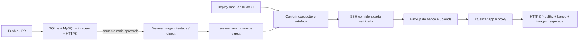
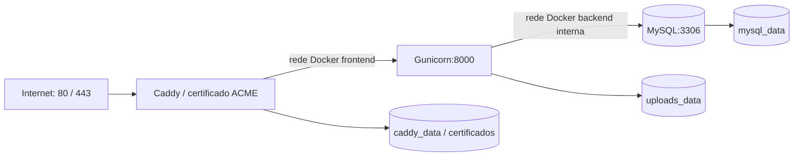

# CI/CD do EduFast

Esta é a fonte de verdade da automação. Os dois pontos de entrada em [workflows](../workflows/) ficam no local obrigatório do GitHub; toda a implementação, configuração de produção e testes ficam aqui.

[Relatório da validação local](VALIDACAO.md)

## Concorrência, regressão e Postman

O backend de cursos MS04 tem [contratos e evidências atuais](../../Documentos/testes/API_CURSOS_MS04_2026-11-20.md).
Para repetir o checkout atual em SQLite/MySQL descartáveis e HTTP Linux:
`python .github/cicd/run_cursos_backend.py --suite regressao`. O código é montado
somente para leitura; a imagem local `edufast-platform:test` fornece dependências.
O runner não aceita banco externo, usa tmpfs/redes próprias e verifica hash de
fonte/limpeza. `--suite ms04` limita a descoberta aos testes novos.

As [correções e evidências](../../Documentos/testes/CONCORRENCIA.md) abrangem
solicitações de documentos, versões de cadastros/notas e idempotência dos envios.
Os novos testes estão em `tests/test_concurrency.py`; a concorrência real exige MySQL.
O CI os executa junto à regressão existente em bancos Docker descartáveis.

`python .github/cicd/review_mutations.py` compara o código em HEAD com o diretório
de trabalho, executa a nova suíte e só então roda a regressão existente em SQLite
temporário. Para MySQL, definir `RACE_TEST_DB_URL` apontando para um banco vazio e
descartável cujo nome comece com `race_ci_`, e acrescentar `--mysql`.

A [coleção Postman](../../Documentos/testes/postman/README.md) tem executor HTTP
isolado. A [migration](../../Códigos/migrations/README.md) continua sujeita à revisão
humana: o CI cria esquemas novos para teste, não aplica o SQL ao banco existente.

## Próxima etapa: testes antes da implementação

O [pacote de revisão TDD](../../Documentos/testes/proxima-versao/README.md) define os contratos futuros de várias escolas e gestão acadêmica. Seu código fica em `next/`, o ambiente em `compose.next.yml` e o executor em `next_stage.py`. Não altera o código da aplicação.

O CI normal confere somente a infraestrutura e a sincronização dos documentos desse pacote. A suíte futura é estrita e tem workflow manual separado em `tdd.yml`: continua RED até a implementação cumprir os contratos. Essa falha não é convertida em aprovação nem usada para publicar uma imagem.

## Estrutura e conectividade

```text
.github/
├── workflows/
│   ├── ci.yml                  # push, PR e execução manual
│   └── deploy.yml              # implantação manual, ambiente production
└── cicd/
    ├── ci.py                   # mesmo executor local e no GitHub
    ├── Dockerfile              # imagem Gunicorn, usuário sem root
    ├── requirements.txt        # servidor de produção
    ├── compose.production.yml  # Caddy + app + MySQL + volumes
    ├── compose.test.yml        # override descartável, portas aleatórias
    ├── Caddyfile               # HTTPS automático no domínio real
    ├── Caddyfile.test          # CA local exclusiva dos testes
    ├── .env.example            # modelo para o servidor
    ├── tests/                  # contratos em SQLite e MySQL
    ├── check_deploy.py         # valida configuração antes de SSH
    ├── verify_release.py       # verifica origem do artefato do CI
    ├── test_deploy.py          # testes dos bloqueios de deploy
    ├── remote.sh               # envia a configuração do commit testado
    └── deploy.sh               # backup e atualização no servidor
```



## Executar os testes

Requisitos: Python 3.10+, Docker ativo, Docker Compose **2.24.4+** e acesso para baixar as imagens. O runtime da aplicação testada é Python 3.12 no container. Na raiz:

```bash
python .github/cicd/ci.py
```

O executor usa um projeto aleatório `edufast-ci-*`, portas locais aleatórias e volumes próprios. Remove somente esses volumes ao terminar. Não usa `.env`, banco ou uploads da aplicação manual. Os valores de teste são fictícios e definidos no executor. O workflow usa Bash com `pipefail`: salvar o log com `tee` não esconde uma falha do CI.

Cobertura da automação:

- Construção da imagem de produção e validação do Compose.
- Sintaxe dos scripts Bash e pré-condições de deploy, incluindo entradas malformadas e origem da release.
- Execução do script de deploy com Docker/HTTPS simulados: sucesso, falha no download, falha no backup, falha ao iniciar e resposta de release incorreta.
- Contratos de login, perfis, JWT, cadastros, turmas, disciplinas e navegação administrativa em SQLite e MySQL.
- Endpoint de saúde com consulta real ao banco e resposta 503 em falha simulada.
- Provisionamento de administrador sem apagar contas ou substituir senhas existentes.
- HTTPS real com CA local confiável; rejeição da mesma CA quando não confiável; HSTS e cookie seguro.
- Dump e restauração do MySQL descartável, e persistência de uploads após recriar o app.

Os resultados ficam em `.ci-results/`, ignorados pelo Git. O GitHub preserva logs e resumo como artefatos. A publicação usa **a mesma imagem local que passou nos testes**, sem reconstrução posterior. Pull requests não publicam imagens nem implantam.

Os testes não representam auditoria integral do produto, teste de carga ou homologação do servidor futuro.

### Fluxos HTTP obrigatórios no CI

O workflow `ci.yml` executa também a coleção Postman com Newman **6.2.1**, instalado
por `npm ci` usando `.github/cicd/http/package-lock.json`, e dependências Python da
aplicação. Esse passo roda antes da publicação: falha HTTP, de persistência ou de
arquivos interrompe o job. O Bash preserva a falha do executor mesmo com `tee`.

Para repetir localmente com Node 22+ e as dependências Python instaladas:

```powershell
Push-Location .github/cicd/http
npm ci --no-audit --no-fund
Pop-Location
python .github/cicd/run_postman.py --newman .github/cicd/http/node_modules/newman/bin/newman.js
```

O executor usa servidor e SQLite temporários, sem migrations. Os artefatos
`.ci-results/mutations/postman.json`, `http.log` (no CI) e `summary.json` são
preservados pelo workflow inclusive em falhas. O resumo identifica commit,
alterações locais, runtime, hash da coleção e resultado completo, incluindo a
conferência dos registros e arquivos. Um resultado antigo é removido antes de
iniciar nova execução. Os limites de execução continuam na descoberta normal de
`tests/`, em SQLite e MySQL.

Automação HTTP não substitui inspeção visual desktop/mobile nem comprova cobertura
das rotas acadêmicas adicionais identificadas no diagnóstico.

O piloto `run_frequencia_api.cjs` também executa `estudos_http.cjs` na mesma
fixture HTTP descartável: JWT por perfil, abas, versões/idempotência, material
multipart, aprovação existente e download antes/depois de arquivar. A descoberta
normal inclui `test_estudos.py` e `test_estudo_abas.py` em SQLite e MySQL.

## Produção proposta



Apenas o proxy publica portas no servidor. App e banco não publicam portas. A comunicação com MySQL ocorre na rede Docker interna do mesmo servidor, sem configuração de TLS entre containers. Para banco remoto ou política que exija criptografia nesse trecho, configure TLS e valide-o antes de usar esse modelo.

O Caddy obtém e renova certificados automaticamente quando o DNS aponta para o servidor e as portas 80/443 estão acessíveis. Não é necessário comprar um certificado separado. Não existe domínio ou servidor real configurado nesta entrega.

## Quando comprar o domínio e o servidor

Modelo suportado: servidor Linux com Docker Compose 2.24.4+, Bash, `flock`, `curl`, `tar`, `gzip`, Python 3, SSH e armazenamento persistente. O usuário de implantação precisa executar Docker; esse acesso deve ser tratado como administrativo.

1. Configure os registros DNS A e, se houver IPv6 funcional, AAAA. Libere HTTP/HTTPS e o SSH administrativo. Não exponha MySQL ou Gunicorn.
2. Configure um usuário de implantação, chave SSH e identidade conhecida do servidor conferida por um canal confiável.
3. Autentique o Docker do servidor no GHCR com credencial de leitura do pacote privado. Não armazene esse token no repositório nem reutilize o token temporário do Actions no servidor.
4. Escolha uma execução aprovada do CI na main. Obtenha seu commit e o digest em `release.json` ou no resumo do job.
5. Copie **a pasta `.github/cicd` do mesmo commit** para `/srv/edufast/releases/<COMMIT>/`. O diretório de release deve conter `compose.production.yml`, `Caddyfile` e `deploy.sh`.
6. Copie `.env.example` para `/srv/edufast/.env.production`, restrinja a leitura (`chmod 600`) e substitua todos os exemplos. Use chaves aleatórias; mantenha senhas do banco compatíveis com qualquer volume existente. Defina a imagem exata `ghcr.io/samucau1/edufast-2.0@sha256:<DIGEST>`.
7. Valide e execute a primeira instalação, substituindo `<COMMIT>` pelo valor real:

```bash
cd /srv/edufast
docker compose -p edufast-production --env-file .env.production -f releases/<COMMIT>/compose.production.yml config --quiet
docker compose -p edufast-production --env-file .env.production -f releases/<COMMIT>/compose.production.yml pull
docker compose -p edufast-production --env-file .env.production -f releases/<COMMIT>/compose.production.yml up -d --no-build --wait --wait-timeout 240
docker compose -p edufast-production --env-file .env.production -f releases/<COMMIT>/compose.production.yml exec app flask --app 'app:create_app()' create-admin
ln -sfn /srv/edufast/releases/<COMMIT> /srv/edufast/current
```

O comando `create-admin` solicita email e senha sem exibir a senha. Recusa substituir contas existentes. Não use o seed antigo em produção.

8. Confira `https://SEU_DOMINIO/healthz`, certificado válido, login e fluxos reais. Faça um ensaio de restauração e mantenha cópia externa dos backups e da configuração antes de autorizar atualizações com dados reais.

## Configurar o GitHub para atualizações

Crie o ambiente `production`, configure revisores/aprovação quando disponível e cadastre:

| Tipo | Nome | Valor |
| --- | --- | --- |
| Variável | `DEPLOY_HOST` | Host/IP do SSH |
| Variável | `DEPLOY_USER` | Usuário de implantação |
| Variável | `DEPLOY_PORT` | Porta SSH; padrão 22 |
| Variável | `DEPLOY_DIR` | Diretório dedicado; exemplo `/srv/edufast` |
| Variável | `PUBLIC_URL` | Origem HTTPS; exemplo `https://escola.exemplo.com` |
| Secret | `DEPLOY_SSH_KEY` | Chave privada exclusiva da implantação |
| Secret | `DEPLOY_KNOWN_HOSTS` | Identidade SSH previamente conferida |

No Actions, execute **CD - Produção (manual)** na main, informe o ID de uma execução aprovada do CI e confirme provisionamento/backup. O CD recusa CI de PR, branch diferente, falha, artefato expirado ou imagem fora do repositório. Configuração ausente bloqueia antes de SSH.

O CD baixa a configuração do mesmo commit testado, envia-a ao servidor por SSH e implanta a imagem por digest. Não depende de um `git pull` no servidor. Os segredos da aplicação permanecem em `.env.production` no servidor.

## Backup e recuperação

A atualização exige uma instalação anterior existente. Com trava de concorrência, baixa a imagem, para o app e copia banco e uploads para `backups/`, com manifesto das imagens antiga/nova. Só depois inicia a nova versão. Há indisponibilidade durante essa etapa.

Em falha no backup tenta religar a imagem anterior. Após iniciar a versão nova não faz downgrade automático: o código legado pode alterar o esquema durante a inicialização. Analise os logs antes de recuperar. Para restaurar, pare o app e use uma combinação compatível de imagem, banco e uploads. Preserve volumes existentes até conferir a restauração.

Os backups locais precisam de retenção, cópia externa, monitoramento e restauração ensaiada. Configuração, credenciais e certificados têm política de recuperação própria. O CI testa dump/restauração em ambiente descartável; não comprova recuperação do servidor que ainda será contratado.

## Limite da preparação

É possível validar agora o pipeline, a imagem, a comunicação entre containers, o HTTPS de teste e os bloqueios de deploy. Homologação SSH remota, DNS, certificado público, capacidade do servidor, observabilidade, regras de acesso do produto e recuperação real dependem do ambiente futuro e da revisão da aplicação. Comprar domínio e servidor não substitui essa etapa.

Referências: [local obrigatório dos workflows](https://docs.github.com/en/actions/concepts/workflows-and-actions/reusing-workflow-configurations), [ordem de inicialização do Compose](https://docs.docker.com/compose/how-tos/startup-order/), [proxy Flask](https://flask.palletsprojects.com/en/stable/deploying/proxy_fix/) e [HTTPS com Caddy](https://caddyserver.com/docs/quick-starts/https).
