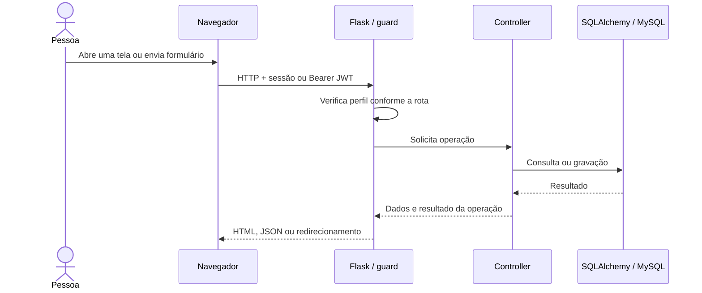
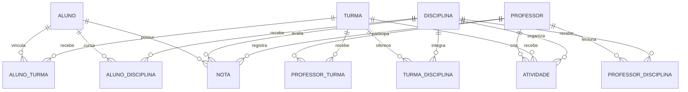
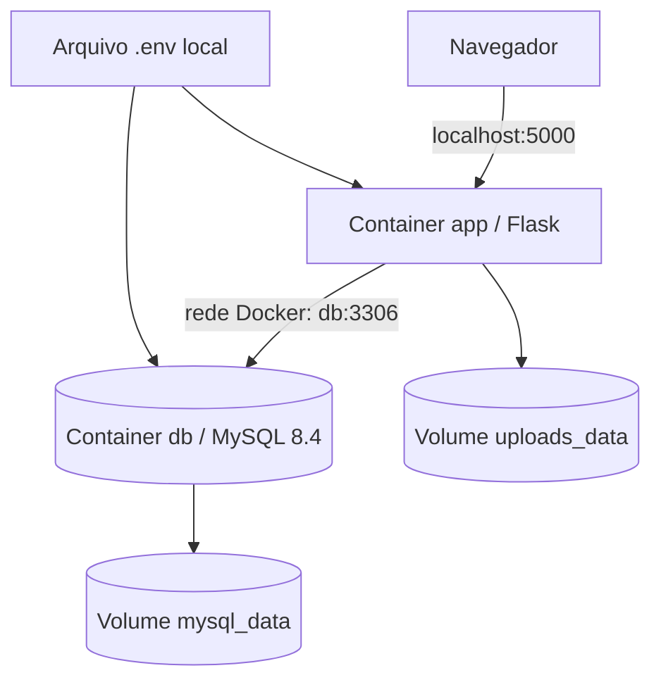

# Arquitetura do EduFast

[Início](../../README.md) · [Documentação](../README.md)

Este documento descreve o código presente em `Códigos/`. Propostas futuras são identificadas separadamente. Revisão documental: 26/10/2026.

## Organização atual

O sistema é um monólito Flask em camadas. A aplicação atende páginas HTML/Jinja e endpoints que retornam JSON. React 18 é carregado por CDN para componentes da interface; não há um projeto SPA separado com build Node neste diretório.

| Componente | Responsabilidade | Local |
| --- | --- | --- |
| Entrada | Cria a aplicação e inicia o servidor de desenvolvimento | `Códigos/app.py` |
| Fábrica | Carrega configuração, inicializa banco e registra blueprints | `app/__init__.py` |
| Configuração | Lê ambiente e monta a conexão do banco | `config.py` |
| Rotas | Recebem requisições, aplicam guards e escolhem a resposta | `app/routes/` |
| Controllers | Cadastro, consultas, notas, atividades e documentos | `app/controllers/` |
| Models | Entidades, relacionamentos e operações de persistência | `app/models/` |
| Banco | Engine SQLAlchemy, sessões e inicialização do esquema | `app/database.py` |
| Views | Funções de renderização compartilhadas | `app/views/` |
| Templates | Estrutura HTML/Jinja e dados da página | `app/templates/` |
| Estáticos | Estilos e interações compartilhadas ou por página | `app/static/` |
| Autenticação | Geração e leitura de JWT e regras auxiliares | `app/auth.py` |

Os caminhos `app/...` desta tabela são relativos a `Códigos/`. Algumas rotas realizam operações de banco diretamente; a separação em camadas ainda não é uniforme.

## Fluxo de uma requisição

A interface usa sessão nas páginas web. Há endpoints com autenticação por JWT HS256. O contrato de acesso deve ser consultado em cada rota; não se deve assumir que toda entrada possui a mesma proteção.

## Modelo de dados atual

| Grupo | Entidades |
| --- | --- |
| Identidade | `UsuarioModel`, `AlunoModel`, `ProfessorModel` |
| Organização | `TurmaModel`, `DisciplinaModel` |
| Vínculos | `AlunoTurmaModel`, `AlunoDisciplinaModel`, `ProfessorTurmaModel`, `ProfessorDisciplinaModel`, `TurmaDisciplinaModel` |
| Pedagógico | `AtividadeModel`, `NotaModel` |
| Comunicação | `ComunicadoModel` |
| Documentação | `DocumentoModel`, `SolicitacaoDocumentoModel` |

Visão resumida dos vínculos acadêmicos, sem representar todas as colunas:

Notas têm unicidade por aluno e disciplina, sem dimensão de período no contrato atual. Os vínculos separados professor–turma e professor–disciplina não equivalem a uma atribuição explícita professor–turma–disciplina. Essas limitações precisam ser resolvidas antes de ampliar o histórico acadêmico.

## Persistência e arquivos

`database.py` cria tabelas com `Base.metadata.create_all()` e executa ajustes pontuais de colunas em bases antigas. Isso não constitui um histórico de migrações versionadas. A evolução deve introduzir migrações revisáveis antes de mudanças complexas.

Uploads são gravados no diretório configurado por `UPLOAD_FOLDER`. No Compose, `uploads_data` persiste arquivos e `mysql_data` persiste o banco. Banco e arquivos precisam de backup coordenado. O repositório não deve armazenar uploads reais.

## Ambiente de execução

O Compose atual é de desenvolvimento: monta o código local no container, publica o banco e executa o servidor Flask com debug na entrada. Não há servidor de produção configurado nesta base. Os arquivos arquivados de CI/CD não alteram esse estado.

## Evolução proposta

Manter inicialmente o monólito e separar regras complexas em serviços de aplicação, evitando criar serviços distribuídos antes de existir necessidade operacional.

| Domínio futuro | Responsabilidades e dados propostos |
| --- | --- |
| Acadêmico | Atribuição docente explícita, período letivo e histórico |
| Cursos | Curso, capítulo, tema, aula, oferta e progresso |
| Pessoas | Colaborador, cargo, contrato e jornada |
| Ponto | Marcação, justificativa, ajuste, aprovação e competência |
| Folha | Eventos, demonstrativos, revisão e fechamento |
| Financeiro | Títulos, parcelas, recebimentos, pagamentos e conciliação |
| Transversal | Permissões por recurso, auditoria e relatórios |

Ponto deve fornecer informações aprovadas para a folha. Fechamento de folha deve produzir registros versionados antes de qualquer integração de pagamento. Mensalidades e recebimentos de alunos pertencem ao financeiro, separados das obrigações com colaboradores. A definição detalhada dessas regras faz parte da implementação futura.

Para várias escolas na mesma instalação será necessário definir instituição/unidade e escopo dos dados e permissões. O modelo atual não comprova isolamento entre instituições.

## Limites conhecidos

- Não há implementação de ponto, folha ou financeiro nesta base.
- O seed atual remove usuários antes de criar o administrador de demonstração.
- Os testes e relatórios de `arquivo/ci2` dependem de arquivos de outra base; não comprovam a validação do código atual.
- Padronização de autorização, migrações, tratamento de arquivos e configuração de produção são etapas de evolução, não garantias já entregues.
- Os protótipos ilustram a direção de produto e não alteram rotas ou entidades.
