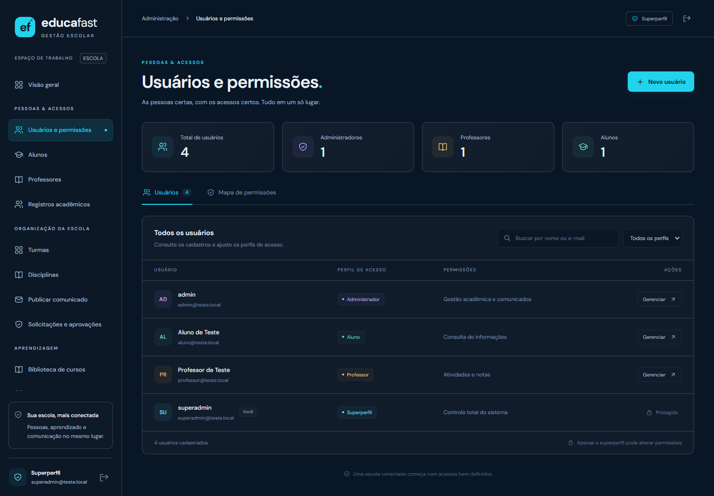

# Referência visual EducaFast

Este catálogo preserva o design funcional recuperado do `Projeto-Educa-Fast`,
commit `cb27d3c`: DM Sans local, navegação lateral, barra superior, cartões e tema
escuro/ciano. A paleta clara/verde usa a personalização do mesmo sistema de tokens.

Leia o [protocolo obrigatório](../PROTOCOLO_DESIGN.md) antes de alterar interfaces.

MS04, 20/11: [cursos e Matemática para o ENEM — comparação e capturas](referencias/2026-11-20-cursos-enem/COMPARACAO.md).
Turmas, 24/11: [registrar a turma na matéria — comparação e capturas](referencias/2026-11-24-turma-materia/COMPARACAO.md).
B3, 23/11: [seletor de turma e painéis sem React — comparação e capturas](referencias/2026-11-23-desempenho-b3/COMPARACAO.md).
B1, 23/11: [notas unificadas nos painéis de professor e aluno — comparação e capturas](referencias/2026-11-23-notas-unificadas/COMPARACAO.md).
As imagens abaixo usam somente contas e dados fictícios do ambiente manual.

## Galeria de 30/10/2026

| Tela | Desktop | Celular |
| --- | --- | --- |
| Login | [Abrir](referencias/2026-10-30-r2/login-desktop.png) | [Abrir](referencias/2026-10-30-r2/login-mobile.png) |
| Usuários e permissões do superperfil | [Abrir](referencias/2026-10-30-r2/usuarios-desktop.png) | [Abrir](referencias/2026-10-30-r2/usuarios-mobile.png) |
| Aparência | [Abrir](referencias/2026-10-30-r2/aparencia-desktop.png) | [Abrir](referencias/2026-10-30-r2/aparencia-mobile.png) |
| Regras e identidade da escola | [Abrir](referencias/2026-10-30-r2/regras-desktop.png) | [Abrir](referencias/2026-10-30-r2/regras-mobile.png) |
| Identidade personalizada | [Abrir](referencias/2026-10-30-r2/identidade-personalizada-desktop.png) | [Abrir](referencias/2026-10-30-r2/identidade-personalizada-mobile.png) |
| Aprovações administrativas | [Abrir](referencias/2026-10-30-r2/aprovacoes-desktop.png) | [Abrir](referencias/2026-10-30-r2/aprovacoes-mobile.png) |
| Painel administrativo | [Abrir](referencias/2026-10-30-r2/admin-desktop.png) | [Abrir](referencias/2026-10-30-r2/admin-mobile.png) |
| Painel do professor | [Abrir](referencias/2026-10-30-r2/professor-desktop.png) | [Abrir](referencias/2026-10-30-r2/professor-mobile.png) |
| Propostas do professor | [Abrir](referencias/2026-10-30-r2/propostas-docentes-desktop.png) | [Abrir](referencias/2026-10-30-r2/propostas-docentes-mobile.png) |
| Painel do aluno | [Abrir](referencias/2026-10-30-r2/aluno-desktop.png) | [Abrir](referencias/2026-10-30-r2/aluno-mobile.png) |
| Acesso negado | [Abrir](referencias/2026-10-30-r2/acesso-negado-desktop.png) | [Abrir](referencias/2026-10-30-r2/acesso-negado-mobile.png) |

[Diálogo de novo usuário](referencias/2026-10-30-r2/novo-usuario.png) ·
[Manifesto e hashes](referencias/2026-10-30-r2/manifesto.json)

## Situacao da validacao

As [abas docentes de 19/11](referencias/2026-11-19-abas-disciplina/manifesto.json)
adicionam 28 capturas atuais do MS02/MS03, com [comparação e limites](referencias/2026-11-19-abas-disciplina/comparacao.md).
Criação, renomeação, ordenação, publicação revisada e arquivamento foram exercitados
em desktop/mobile; ativação persistente depende da revisão das propostas 005/006.

O [espaço da disciplina de 16/11](referencias/2026-11-16-espaco-disciplina/manifesto.json)
adiciona 16 capturas de avisos, materiais e rascunhos, com
[comparação e limites](referencias/2026-11-16-espaco-disciplina/comparacao.md).

A [confirmação direta de chamada de 16/11](referencias/2026-11-16-chamada-direta/manifesto.json)
tem 14 novas capturas desktop/mobile e [comparação](referencias/2026-11-16-chamada-direta/comparacao.md).
Os [resultados e limites atuais](../testes/CHAMADA_DIRETA_2026-11-16.md) distinguem
validação SQLite/HTTP/navegador da concorrência MySQL ainda pendente.

O [painel do proprietário de 12/11](referencias/2026-11-12-plataforma/manifesto.json)
possui oito capturas novas, com [comparação e limites](referencias/2026-11-12-plataforma/comparacao.md),
preservando as referências escolares anteriores.

A revisao r2 passou na execucao completa do navegador: login, quatro perfis,
superperfil, formularios, identidade personalizada e acesso negado, em 1440×1000
e 390×844, sem erros JavaScript e sem rolagem horizontal na pagina.

A selecao da representacao HTML/JSON foi corrigida sem alterar a autorizacao:
acesso negado continua HTTP 403; os 18 contratos antigos da API foram repetidos
e passaram. O CI completo registrou 96 testes MySQL e 96 SQLite (15 cenarios
exclusivos de MySQL ignorados neste ultimo); a suite restaurada teve mais uma
rodada focada MySQL aprovada. Postman: 57 requisicoes e 65 assercoes aprovadas.

A [primeira referencia de 21 imagens](referencias/2026-10-30/manifesto.json),
anterior ao fechamento da pendencia visual, permanece preservada. A galeria
principal usa os 23 prints da r2, incluindo a tela de acesso negado.

[Relatorio e limites da entrega](../testes/ENTREGA_RESTAURACAO.md).
Configuracoes, bancos, logs e capturas temporarias continuam fora do Git.
