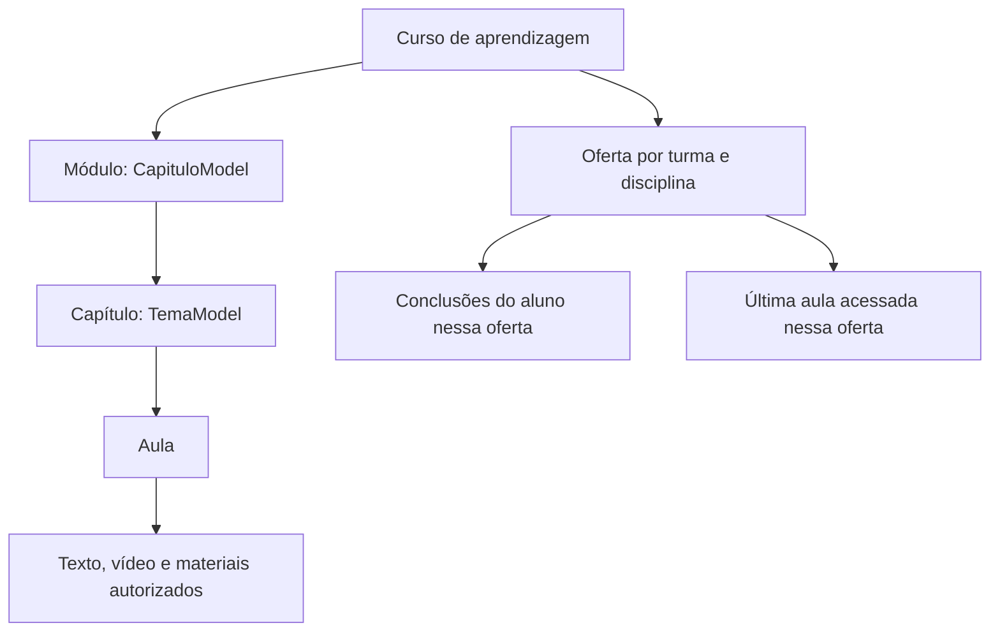

# Estudo MS04 — cursos modulares e retomada do aluno

Data: 19/11/2026. Base inspecionada: `aedf8ad4b81ee654857e82b40678086d12aebe72`.
Complementa o [plano de ensino médio e superior](ENSINO_MEDIO_SUPERIOR_2026-11-16.md).
Preparação seguinte: [esqueleto, caminhos e sequência de 20/11](ESQUELETO_MS04_2026-11-20.md).
Este documento estuda o próximo lote; não implementa funcionalidades, altera
permissões ou autoriza migrations. O objetivo continua sendo um produto para
demonstração e venda, com instalação real após definição de cliente.

## 1. Direção e decisões confirmadas

O MS04 deve consolidar a experiência já existente, com duas decisões expressas do
usuário nesta conversa:

1. **Curso → módulos → capítulos → aulas**, aproveitando os níveis existentes.
2. **Continuar estudando abre a última aula acessada**, mesmo sem conclusão.

Recomendação do estudo: conservar cursos publicados como edições imutáveis,
dar autonomia ao autor nos próprios rascunhos, manter revisão para publicação e
separar retomada de conclusão. Acrescentar aulas em texto e materiais de apoio
sem obrigar um vídeo fictício. Estas recomendações ainda não representam aceite
das decisões adicionais listadas ao final.

Não é necessário começar uma nova plataforma de cursos nem criar uma tabela
`modulos` que duplique a hierarquia atual.

## 2. O que existe e o que precisa evoluir

| Parte | Comportamento identificado/observado | Consequência para MS04 |
| --- | --- | --- |
| Estrutura | `CursoModel → CapituloModel → TemaModel → AulaModel` | Mapear nomes de apresentação, preservando IDs, tabelas e relações |
| Organização | Adicionar, editar, subir/descer e remover itens de rascunho; posições únicas por pai | Reutilizar operações; melhorar contexto, estado e tratamento de conflito |
| Autoria | Curso tem professor responsável e disciplina; exige vínculo docente com a disciplina | Preservar autoria da biblioteca; conferir separadamente a oferta quando houver contexto de turma |
| Fluxo docente | Interceptador transforma POSTs de cursos em propostas; até criar rascunho aguarda aprovação | Autonomia exige mudança explícita e restrita no interceptador, não apenas botões novos |
| Publicação | Administração publica; capítulos/temas não podem estar vazios | Manter revisão e validação da estrutura, com nomes compatíveis com a nova interface |
| Edição publicada | Estrutura publicada não pode ser editada; duplicação cria rascunho com `origem_id` | Usar esse mecanismo como base das novas edições |
| Ofertas | Um curso pode ser liberado para diferentes pares turma/disciplina | Manter material separado da oferta; não confundir curso de aprendizagem com graduação |
| Acesso discente | Aluno ativo, turma vinculada e ativa, curso publicado e oferta ativa | Falta conferir vínculo com a disciplina, já exigido pelo Espaço da disciplina |
| Aprendizagem | Índice, aula atual, anterior/próxima e conclusão explícita existem | Consolidar o percurso; não anunciar essas partes como inexistentes |
| Progresso | Uma conclusão por aluno/oferta/aula, com constraint única | Preservar e reutilizar; não converter em presença, nota ou certificado |
| Retomada | Sem aula na URL, abre a primeira ainda não concluída | Não atende à decisão de última aula acessada; falta persistir cursor próprio |
| Formato da aula | `video_id` obrigatório no banco e no formulário; descrição em texto | Aula sem vídeo precisa de contrato, alteração de esquema e renderização por tipo |
| Materiais | MS02 tem links/arquivos privados por oferta, fora da árvore de cursos | Reaproveitar padrões de proteção; definir autorização própria dos materiais de aula |
| Leveza | Estrutura do curso usa até três SELECTs; biblioteca percorre ofertas e busca dados por oferta | Preservar melhoria MS00, evitar leituras repetidas e paginar a biblioteca |

Fontes: [modelos](../../Codigos/app/models/curso_model.py),
[rotas](../../Codigos/app/routes/curso_routes.py),
[serviço](../../Codigos/app/services/cursos.py),
[interceptador](../../Codigos/app/restauracao.py),
[transação de aprovação](../../Codigos/app/services/restauracao_context.py) e
templates `curso_biblioteca.html`, `curso_editor.html`, `curso_aprender.html`.

### Verificação dirigida nesta tarefa

Foi usado SQLite em memória, com configuração sintética, opt-in de teste e
fixtures que criam somente esquema descartável. Não houve consulta a bancos
persistentes nem execução de migrations. O diagnóstico exercitou rotas Flask
reais por test client, sem simular suas respostas:

- Aluno vinculado à turma, sem `AlunoDisciplinaModel`: curso respondeu **200**;
  o Espaço da disciplina respondeu **404**. A divergência precisa ser conciliada.
- Abrir Aula 2 sem concluir e voltar por Continuar abriu **Aula 1**.
- Repetir conclusão deixou **um único registro** de progresso.
- Alterar curso publicado foi recusado; duplicação criou rascunho independente
  sem copiar progresso do aluno.
- Criação docente respondeu **202**, sem criar curso imediatamente.
- Aula sem vídeo foi recusada com **400**, mesmo com descrição preenchida.
- Na página de aprendizagem com duas aulas houve **16 SELECTs**, incluindo duas
  leituras de aulas: uma em `aulas_curso()` e outra em `estrutura()`. É uma amostra
  funcional pequena, não benchmark de capacidade nem meta de consultas aprovada.

Também foram repetidos `test_course_outline` e `test_restauracao`: **18 testes,
17 aprovados e um exclusivo de MySQL ignorado**, em 6,515 s. O teste de consultas
MS00 continua válido para `estrutura()`; ele não comprova o custo da página inteira.
Não foi repetida a regressão geral, o navegador ou o MySQL neste estudo documental.
O CI aprovado da entrega anterior não é aceite das funcionalidades propostas aqui.

Artefatos locais ignorados: `.ci-results/ms04-2026-11-19/diagnostico.py`,
`diagnostico.json` e `testes-focados.log`. A primeira tentativa do diagnóstico
usou um pai da edição original para adicionar aula na cópia e recebeu 404; o
executor foi corrigido para usar o pai da cópia. O resultado registrado acima
é da execução final concluída; não houve correção do produto nesta tarefa.

## 3. Organização proposta

| Nome mostrado | Modelo/tabela atual | Exemplo |
| --- | --- | --- |
| Curso | `CursoModel` / `cursos` | Matemática: funções |
| Módulo | `CapituloModel` / `curso_capitulos` | Funções do primeiro grau |
| Capítulo | `TemaModel` / `curso_temas` | Interpretação de gráficos |
| Aula | `AulaModel` / `curso_aulas` | Identificando coeficientes |

O mapeamento é de linguagem da interface. Não renomear tabelas, IDs, payloads
legados (`tipo=capitulo/tema/aula`) ou registros silenciosamente. A camada de
apresentação traduz os rótulos; APIs existentes mantêm seu contrato enquanto
houver clientes/testes que o utilizem. Títulos gravados pelo professor não serão
reescritos. O caminho completo deve aparecer no editor e na leitura do aluno.

Módulos e capítulos vazios podem existir no rascunho, com orientação para
preenchimento; publicação exige estrutura completa e ao menos uma aula válida
em cada capítulo. No início, manter ordenação por Subir/Descer e ações por item,
sem depender de arrastar no celular. Reordenar conserva a identidade das aulas.

## 4. Jornada docente e publicação

Fluxo proposto: **criar rascunho → organizar módulos/capítulos/aulas → pré-visualizar
→ solicitar publicação → revisão → publicar → liberar oferta pela administração**.

O professor deve conseguir salvar seu próprio rascunho e duplicar uma edição
autorizada sem esperar uma aprovação para cada título, aula ou movimento. Isso
é uma mudança de comportamento proposta para MS04. Exige restringir a exceção
em `recovered_boundary()` a operações de rascunho do módulo de cursos, com
autoria, vínculo atual e transação conferidos no servidor. Não liberar todos os
POSTs docentes de `cursos`/`academico` nem afetar notas.

Publicar e atribuir a turmas continuam sendo ações distintas. Recomenda-se uma
solicitação específica de publicação do curso, limitada ao curso/versão/snapshot
enviado. Aprovação valida novamente o autor, os vínculos e a estrutura. Edição
posterior invalida o pedido anterior; a administração não pode publicar uma
versão diferente daquela revisada. Propostas docentes antigas devem continuar
decidíveis pelos seus contratos atuais, sujeitos às verificações existentes.

O fluxo atual permite revisão docente limitada de alguns materiais, mas publicar
curso é administrativo. Não conceder publicação a revisores docentes por herança
do novo tipo de solicitação. Essa ampliação precisaria de decisão específica.

Estados de apresentação propostos: Rascunho, Em revisão, Revisão desatualizada,
Publicado e Arquivado. Revisão pode ser derivada da solicitação; não duplicar
obrigatoriamente esses estados em `CursoModel.estado`. Mostrar o motivo da recusa
e permitir novo envio da versão corrigida.

Curso publicado permanece imutável. Para mudar conteúdo, duplicar para nova
edição; não reapontar ofertas existentes automaticamente. A nova edição tem
novos IDs de aula e seu próprio progresso. O progresso antigo permanece ligado
à edição/oferta anterior; não copiá-lo como se o aluno já tivesse estudado o
conteúdo novo. Administração escolhe a oferta destinada a cada turma e evita
liberar duas edições sem esclarecer isso ao aluno.

## 5. Jornada do aluno e retomada

Entrada pela biblioteca ou pelo contexto da disciplina autorizada. Mostrar turma,
disciplina, curso e edição; o acesso vem da oferta liberada, não de conhecer a URL
ou pertencer à instituição. Arquivar turma/curso ou revogar oferta retira o acesso,
preservando conclusões e cursor para histórico.

Regra de entrada confirmada: se houver cursor válido, abrir **a última aula
acessada**, concluída ou não. Sem cursor (inclusive dados anteriores), usar a
primeira não concluída; se todas estiverem concluídas, abrir a primeira com o
curso identificado como concluído. Uma aula explicitamente escolhida no índice
prevalece sobre a sugestão de retomada.

Recomenda-se cursor persistido por **aluno + oferta**, com aula, atualização e
versão. A mesma aula acessada em outra oferta não modifica essa retomada. Não
reutilizar `concluida_em`: abrir e concluir são eventos diferentes. Não guardar
somente no navegador, pois o aluno pode alternar entre celular e computador.

O registro de abertura precisa ser uma operação autenticada e pequena, com
verificação da oferta/aula e controle de concorrência. Preferir POST com CSRF
e navegação com redirecionamento; prever formulários sem JavaScript e tratamento
da entrada por URL direta. A solução concreta de navegação deve ser fechada no
contrato antes da implementação: leitura simples não pode marcar conclusão.
Com duas abas/dispositivos, versão antiga não deve sobrescrever silenciosamente
um acesso mais recente; erro de cursor não deve apagar conclusões.

Anterior/Próxima respeitam a ordem global de módulo, capítulo e aula. Na primeira
ou última aula, não mostrar ação impossível. Ao voltar do curso, manter o contexto
da disciplina/oferta. Concluir é confirmação explícita, repetível sem duplicar;
não significa assistir ao vídeo integralmente, presença, nota ou certificação.
Uma ação de conclusão não deve marcar como acessada uma próxima aula que ainda
não foi aberta. Retomar o segundo exato de um vídeo fica fora do primeiro lote.

O percentual usa conclusões válidas do aluno naquela oferta e aulas daquela
edição. Oferta sem aulas não divide por zero. Validar os IDs envolvidos no servidor;
as FKs individuais existentes não comprovam sozinhas que aula e oferta pertencem
ao mesmo curso.

## 6. Aulas sem dependência obrigatória de YouTube

Proposta inicial: **aula em vídeo ou aula em texto**, ambas com materiais de apoio
opcionais. O YouTube continua funcionando para aulas legadas; texto deixa de ser
apenas descrição. Link/PDF podem acompanhar uma aula em texto, sem criar quatro
fluxos de conclusão diferentes.

| Recurso | Proposta para MS04 | Limite inicial sugerido |
| --- | --- | --- |
| Vídeo YouTube | Reutilizar validação de ID/HTTPS; carregar player por ação do aluno | Sem autoplay nem promessa de disponibilidade do vídeo externo |
| Texto | Corpo próprio da aula, com renderização escapada e parágrafos | Texto simples; sem HTML/scripts arbitrários; limite deve ser definido |
| Link de apoio | HTTPS validado, abertura externa identificada | Sem buscar URL no servidor; sem credenciais na URL |
| Arquivo de apoio | PDF/PNG/JPEG privado, cifrado e autorizado pela oferta/aula | Proposta: até 5 MiB, como MS02; sem Word/ZIP nesta etapa |
| Vídeo enviado ao servidor | Fora do primeiro MS04 proposto | Exigiria estudar armazenamento, transferência, processamento e operação |

Validar pelo menos o recurso principal do tipo escolhido: vídeo válido para aula
em vídeo; corpo não vazio para aula em texto. Não usar ID fictício de YouTube,
string vazia para fingir vídeo ou desativar validações para contornar o banco.
Material de apoio não conta como outra aula concluída.

Há duas alternativas de arquivos: referenciar o conteúdo MS02 ou ter recursos
próprios da aula. **Recomendação: recursos próprios da aula**, reutilizando
utilitários/padrões de cifra, validação e download privado. O MS02 pertence a uma
oferta e pode ser arquivado independentemente; o curso pode ser reutilizado em
várias ofertas. Um atalho direto para aquele download pode negar um acesso válido
ou liberar conteúdo em contexto errado. Compartilhar bytes, se futuramente
necessário, exige referência e retenção próprias; não compartilhar autorização
implicitamente nem usar documentos pessoais/atestados.

Uma ligação de curso no Espaço da disciplina deve apontar para a **oferta**
autorizada, nunca para o editor por ID de curso. A inclusão dessa ligação nas abas
MS03 é um sublote posterior à consolidação das permissões e das ofertas.

## 7. Impacto técnico e proteção do legado

| Área | Evolução provável | Cuidado de compatibilidade |
| --- | --- | --- |
| Hierarquia | Rótulos e apresentação | Sem nova árvore/tabelas de módulos ou conversão de títulos |
| Rascunhos | Autoria direta e versão monotônica do agregado curso | Snapshot de aprovação e atualização atômica de estrutura/material |
| Retomada | Tabela nova com unicidade aluno/oferta e referência de aula | Dados antigos continuam sem cursor; não inferir visita pela conclusão |
| Aulas | Tipo, corpo textual e `video_id` opcional conforme tipo | Preencher aulas existentes como vídeo; manter IDs e progressos |
| Apoios | Recursos de aula e metadados de arquivo/link, se incluídos | Edição publicada imutável; duplicação, arquivo e retenção definidos |
| Biblioteca | Filtrar ofertas autorizadas no SQL, paginar e agregar totais | Não carregar todas as ofertas nem textos/players na listagem |
| Aprendizagem | Ler índice leve e conteúdo da aula selecionada | Evitar consultar aulas duas vezes e trazer todos os corpos de texto |

O campo `versao` proposto controla gravações do rascunho; não confundir com edição
pedagógica. Uma gravação de título e outra de ordenação concorrem pela mesma
versão do curso, com conflito 409 e sem aplicar parcialmente. Arquivos criados
em tentativa malsucedida não podem ficar órfãos; exclusão física exige verificar
referências/retenção, sobretudo em duplicação de edições.

Uma estratégia de duplicação pode compartilhar um objeto binário imutável com
referências privadas por aula, ou copiar o arquivo cifrado. A escolha depende do
volume e da retenção; até fechá-la, não prometer limpeza automática nem reutilizar
uma referência cuja autorização depende da oferta original.

Se essas capacidades forem aceitas, preparar proposta futura de migration,
conferindo numeração disponível depois de 005/006. Não executar SQL neste estudo.
Revisão deve cobrir schema/tipos/defaults, aulas legadas, backup de banco/uploads/
chave, ensaio isolado e comportamento antes/depois da ativação. Reverter somente
código após criar aulas sem vídeo pode ser incompatível com o player antigo;
o plano de atualização deve bloquear esse retorno inseguro.

Manter o layout EducaFast e os componentes compartilhados. Este estudo não altera
templates nem é homologação visual. As futuras mudanças de tela exigem protocolo,
desktop/mobile, teclado e novas capturas datadas. Metas de desempenho continuam
propostas; medir antes de prometer capacidade em equipamentos modestos.

## 8. Sequência de implementação recomendada

| Lote | Trabalho | Evidência para encerrar |
| --- | --- | --- |
| MS04-A | Fechar contratos, nomes, acesso aluno/oferta e compatibilidade de payloads | Aluno sem disciplina recusado; oferta alheia não abre aula/download; critérios abaixo especificados |
| MS04-B | Autoria direta dos próprios rascunhos, versão e pedido de publicação | Outro docente recusado; edição antiga conflita; aprovação não publica versão alterada; notas intactas |
| MS04-C | Navegação, conclusão e retomada persistida | Última aula recuperada entre sessões/dispositivos; repetição/concorrência não perde progresso |
| MS04-D | Aula em texto e materiais privados, conforme escopo aprovado | Legado YouTube preservado; texto sem vídeo; recursos recusados em oferta alheia; duplicação segura |
| MS04-E | Ligação pela disciplina, biblioteca leve e jornada completa | Paginação/consultas medidas; player sob demanda; fluxo professor/admin/aluno em desktop/mobile |

Cada lote inclui os testes afetados; não adiar autorização ou preservação de
progresso para a revisão final MS05. Antes de programar alterações de esquema,
consolidar a proposta inteira e seu caminho de ativação para evitar migrations
contraditórias. Não há estimativa de prazo ou promessa comercial neste estudo.

### Matriz mínima de aceite

| Cenário | Resultado esperado |
| --- | --- |
| Criar/organizar rascunho próprio | Persiste sem aparecer ao aluno; não espera aprovação a cada edição |
| Outro professor ou vínculo revogado | Não altera rascunho, pedido ou recursos sem autorização |
| Duas edições/reordenações concorrentes | Um efeito válido; versão antiga recusada; posições preservadas |
| Pedido de publicação seguido de edição | Aprovação da versão antiga recusada; nova revisão explícita |
| Aula/percurso de outro curso/oferta | Leitura, cursor, conclusão e download recusados |
| Aluno sem turma ou sem disciplina | Acesso recusado em todos os caminhos, incluindo URL direta |
| Aula 3 aberta e não concluída | Reentrada abre Aula 3, inclusive em outra sessão |
| Duas abas tentando salvar retomada antiga | Sem sobrescrita silenciosa ou perda de conclusões |
| Concluir duas vezes/concorrência MySQL | Um registro por aluno/oferta/aula e percentual correto |
| Reordenar e duplicar curso | Identidades preservadas na edição original; progresso não transferido à cópia |
| Revogar/arquivar oferta, turma ou curso | Acesso e download recusados; registros históricos preservados |
| Texto sem vídeo e aula YouTube legada | Ambos renderizam; nenhum vídeo fictício; texto escapado |
| Arquivo inválido, falha de transação e repetição de upload | Sem metadados incompletos, duplicação ou arquivo órfão |
| Curso grande, grupos vazios, primeira/última aula e 100% | Navegação correta; erro compreensível; sem divisão por zero |
| JavaScript indisponível, teclado e mobile | Fluxo básico completo e retomada com alternativa funcional |

Testar em SQLite e MySQL descartáveis, incluindo concorrência real; HTTP com JWT,
CSRF por sessão, revisão e downloads; regressão do MS02/MS03 e das aprovações;
inspeção visual e medidas separadas de consultas/assets/latência/memória. O
resultado histórico de 190 testes não cobre os novos contratos antes de existirem.

## 9. Decisões ainda abertas

1. Aceitar autoria direta no rascunho e revisão apenas na publicação, mantendo
   publicação/liberação de ofertas sob administração? É a recomendação, mas muda
   o comportamento atual e precisa ser explicitamente fechado para implementação.
2. Incluir no primeiro MS04 aulas em texto e apoios PDF/PNG/JPEG/link? Definir
   limites de texto, quantidade de anexos e política de duplicação/retenção.
3. Manter navegação livre na edição publicada, sem bloquear a próxima aula por
   conclusão? Recomenda-se começar assim; pré-requisitos/liberação por data são
   uma evolução separada.

Já confirmados: quatro níveis e última aula acessada. Não fazem parte do primeiro
MS04 proposto: hospedagem de vídeo, segundos assistidos, provas/certificados,
pagamento de curso, pré-requisitos e aproveitamento automático entre edições.
Esses limites não impedem uma demonstração completa de autoria, publicação e estudo.
