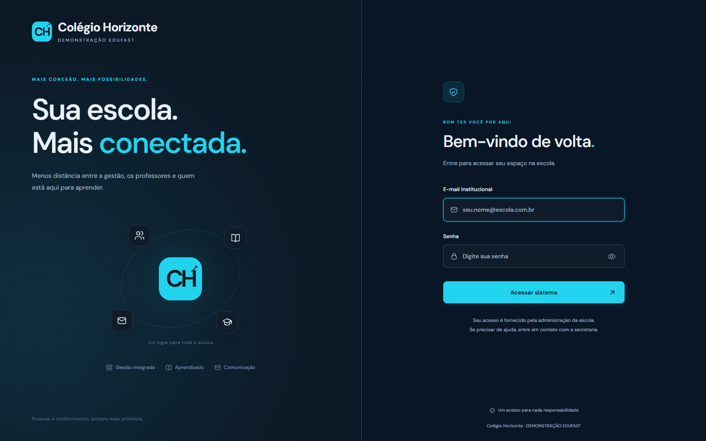
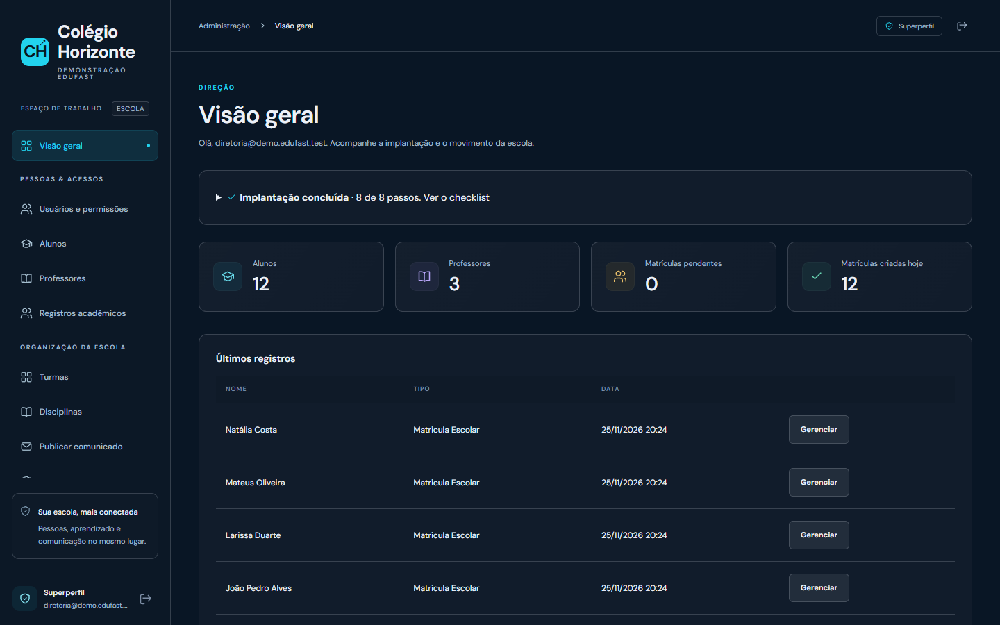
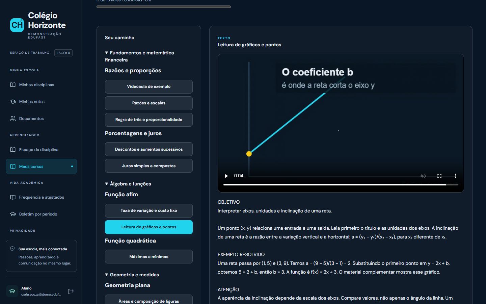
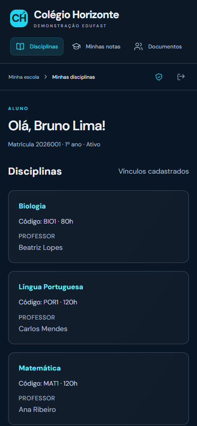
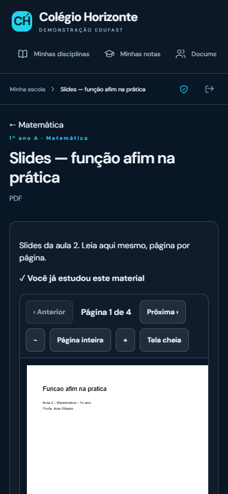
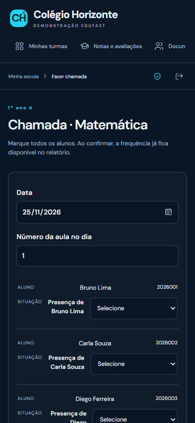
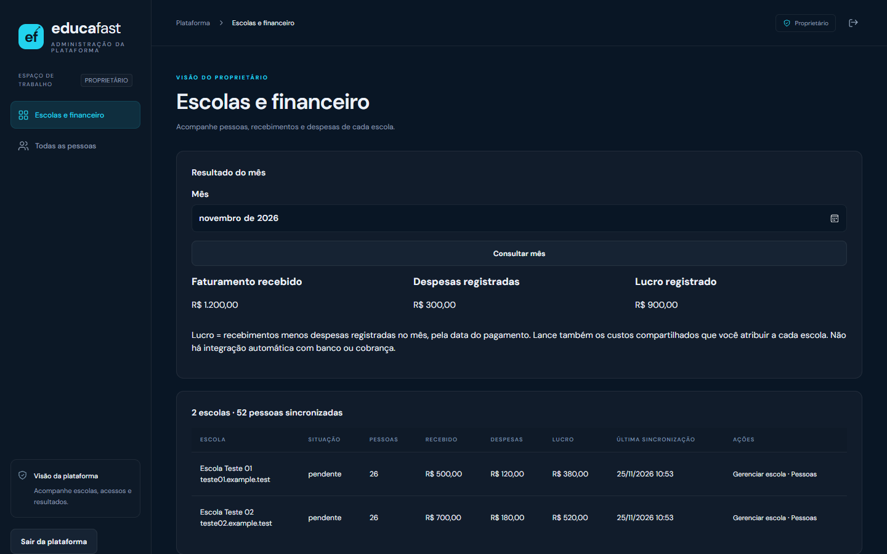
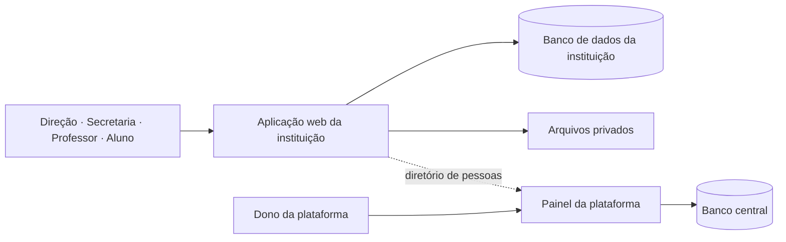

# EduFast 2.0

### Menos burocracia. Mais tempo para a educação.

[](https://github.com/Samucau1/edufast-2.0/actions/workflows/ci.yml)

O **EduFast** é uma plataforma de gestão escolar que reúne direção, secretaria, professores e
alunos no mesmo lugar: turmas, chamada, notas, materiais de estudo, cursos e comunicação.

Ela foi feita para ser **simples de usar, leve em computadores e celulares modestos, e segura
por padrão**. Cada instituição tem a própria instalação, os próprios dados e a própria
identidade visual. Agora uma mesma instituição também pode ter **colégio e faculdade** juntos,
com secretarias separadas.

<p align="center">
  
</p>

> As telas desta página são capturas reais da versão atual, feitas na escola de demonstração
> **Colégio Horizonte**, com dados fictícios.

[Por que EduFast](#por-que-edufast) ·
[Tour pelas telas](#tour-pelas-telas) ·
[Funcionalidades](#funcionalidades) ·
[Arquitetura](#arquitetura) ·
[Tecnologias](#tecnologias) ·
[Situação](#situação-e-próximos-passos)

## Por que EduFast

| | |
| --- | --- |
| **Um caminho por tarefa** | Cada tarefa tem uma tela só, e as telas vazias dizem qual é o próximo passo |
| **Implantação guiada** | A direção encontra um checklist de **Primeiros passos**, dos dados da escola até o primeiro acesso do aluno |
| **A escola no controle** | O que o professor envia, como notas e materiais, passa pela aprovação da secretaria. A avaliação inteira chega como uma solicitação, aprovada em lote |
| **Estudo dentro da plataforma** | PDFs, slides, imagens e vídeos abrem num leitor próprio, sem baixar arquivos |
| **Colégio e faculdade** | Uma instituição pode ter as duas unidades. Cada secretaria vê só a sua, e a direção vê tudo. O aluno que conclui o ensino médio sobe para a faculdade levando o histórico |
| **Leve** | Páginas enxutas, pensadas para conexões e aparelhos simples |
| **Acessível** | Telas verificadas automaticamente nas regras de acessibilidade WCAG, no computador e no celular |
| **Privacidade** | Dados de cada instituição separados e arquivos privados. O painel central da plataforma não acessa notas nem documentos das escolas |

## Tour pelas telas

### Direção: implantação guiada



### Secretaria: uma tela para cada turma

Matérias, professores e alunos de cada turma no mesmo lugar.


### Professor: chamada e diário


### Secretaria: aprovação em lote


### Aluno: disciplinas, materiais e boletim


### Cursos modulares

O curso é organizado em módulos, capítulos e aulas, e o aluno retoma de onde parou. A
videoaula enviada pela professora é assistida dentro da plataforma.



### No celular

<p align="center">
  
  
  
</p>

### Painel da plataforma

O dono da plataforma acompanha as escolas e o resultado do mês num painel próprio.



## Para quem

| Perfil | O que faz |
| --- | --- |
| Dono da plataforma | Cadastra instituições e acompanha a plataforma |
| Direção | Implantação, identidade visual, usuários e calendário. Numa instituição com colégio e faculdade, vê as duas unidades |
| Secretaria | Alunos, professores, turmas, matrículas, documentos e aprovações da própria unidade |
| Professor | Chamada, diário de notas, materiais e cursos das turmas atribuídas |
| Aluno | Disciplinas, materiais, cursos, frequência, boletim e documentos |

## Funcionalidades

| Módulo | O que inclui | Situação |
| --- | --- | --- |
| Secretaria | Alunos, professores, disciplinas, turmas e matrículas | Pronto |
| Implantação guiada | Checklist de primeiros passos e telas vazias com o próximo passo | Pronto |
| Aprovações | Solicitações do professor, aprovação em lote, filtro por situação | Pronto |
| Chamada e atestados | Chamada confirmada pelo professor; atestados analisados pela secretaria | Pronto |
| Diário e boletim | Avaliações com peso, notas aprovadas, média por período | Pronto |
| Espaço da disciplina | Avisos, materiais, abas do professor e progresso do aluno | Pronto |
| Leitor e vídeos | PDFs, imagens e vídeos dentro da plataforma | Pronto |
| Cursos modulares | Módulos, capítulos e aulas, com publicação revisada e retomada | Pronto |
| Documentos e comunicação | Solicitações de documentos e comunicados | Pronto |
| Identidade da escola | Nome, cores, tema, calendário e políticas | Pronto |
| Painel da plataforma | Instituições, pessoas e financeiro da plataforma | Pronto |
| **Colégio e faculdade** | Unidades com secretarias separadas, troca de unidade e subida do concluinte para a faculdade | **Em desenvolvimento**: regras prontas, telas em construção |
| Ensino superior | Ofertas de disciplina por período e inscrição do aluno | Modelo aprovado |
| Passagem de ano | Levar a turma para o ano seguinte | Planejado |
| RH, ponto, folha e financeiro escolar | Colaboradores, jornadas e mensalidades | Planejado |

## Arquitetura

Uma aplicação web completa por instituição, com um painel central separado para a gestão da
plataforma.



Princípios do projeto:
- **Isolamento:** cada instituição tem a própria instalação e os próprios dados. Dentro da
  instituição, cada unidade (colégio e faculdade) tem a secretaria separada.
- **Controle de mudanças:** alterações no banco de dados são revisadas antes de qualquer
  aplicação.
- **O painel central conhece pouco:** recebe só o necessário para gerir a plataforma, e nunca
  notas, documentos ou senhas.
- **Qualidade:** cada entrega passa por testes automatizados, verificação de acessibilidade e
  revisão visual.

## Tecnologias

| Camada | Tecnologias |
| --- | --- |
| Interface | HTML, CSS com design system próprio, JavaScript sem framework |
| Aplicação | Python e Flask |
| Dados | PostgreSQL |
| Infraestrutura | Docker |
| Qualidade | Testes automatizados, testes de navegador e auditoria de acessibilidade |

## Experimente

Requisitos: Git, Docker (no Windows, o Docker Desktop aberto) e Node.

```powershell
git clone https://github.com/Samucau1/edufast-2.0.git
cd edufast-2.0
node infra/demo-completa.cjs start
```

O comando sobe a escola de demonstração com dados fictícios e mostra na tela o endereço e as
contas de teste de cada perfil. Ela funciona só no seu computador.

## Situação e próximos passos

**Novembro de 2026: beta funcional, pronto para um piloto controlado.** Nenhuma instalação de
produção foi homologada ainda.

Próximos passos:
1. **Colégio e faculdade:** telas da troca de unidade e escolha do tipo de instituição no painel
   da plataforma.
2. **Ensino superior:** ofertas por período e inscrição do aluno.
3. **Passagem de ano.**
4. **Teste de usabilidade com pessoas reais.**
5. **RH, ponto, folha e financeiro escolar.**

## Contribuir

Leia o [AGENTS.md](AGENTS.md) e o [protocolo de design](Documentos/PROTOCOLO_DESIGN.md) antes de
alterar as telas. Não versione configurações locais, bancos, arquivos enviados, chaves, nem dados
reais de alunos e colaboradores.

## Licença

Distribuído sob a [licença MIT](LICENSE), com os créditos originais preservados.
