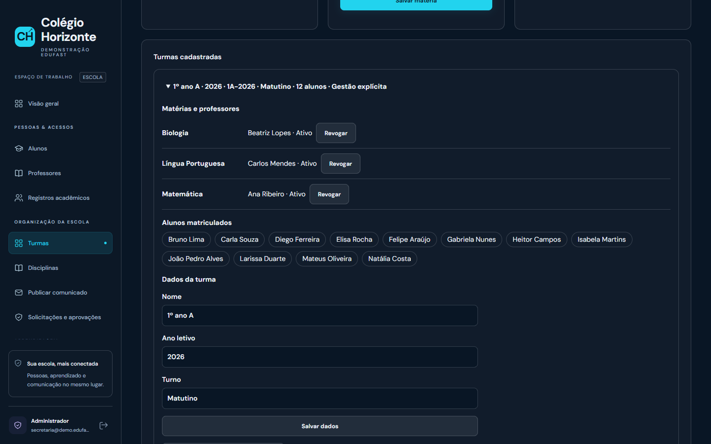
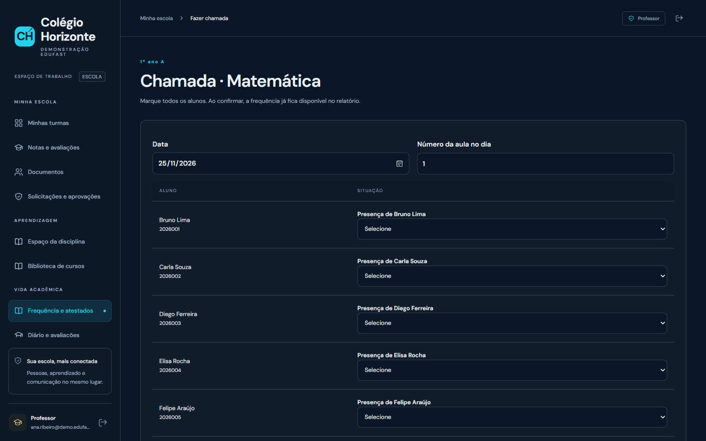
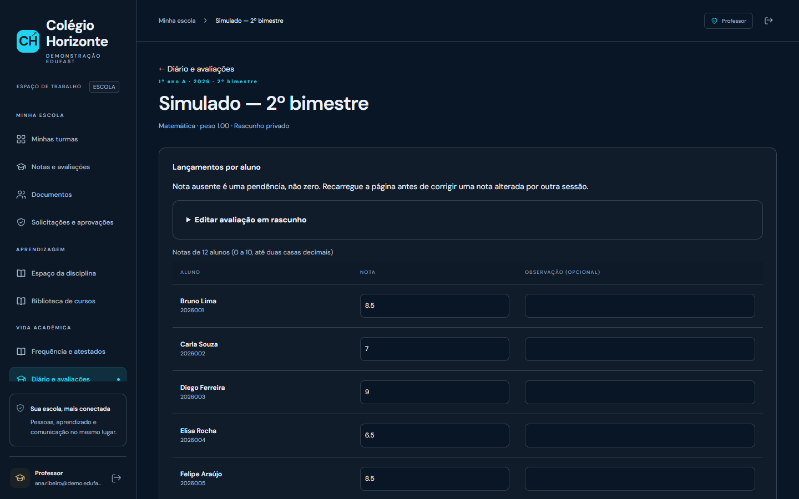
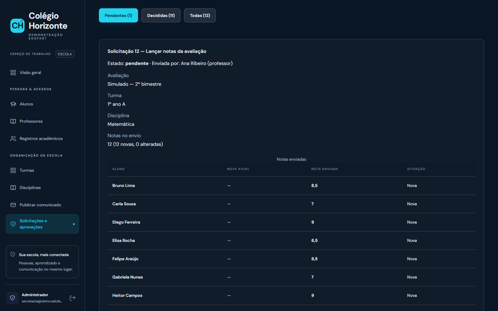
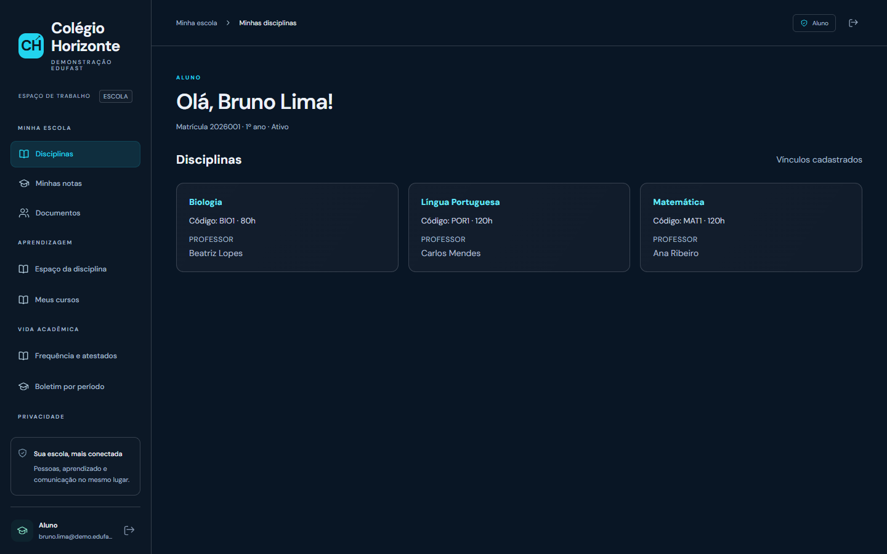
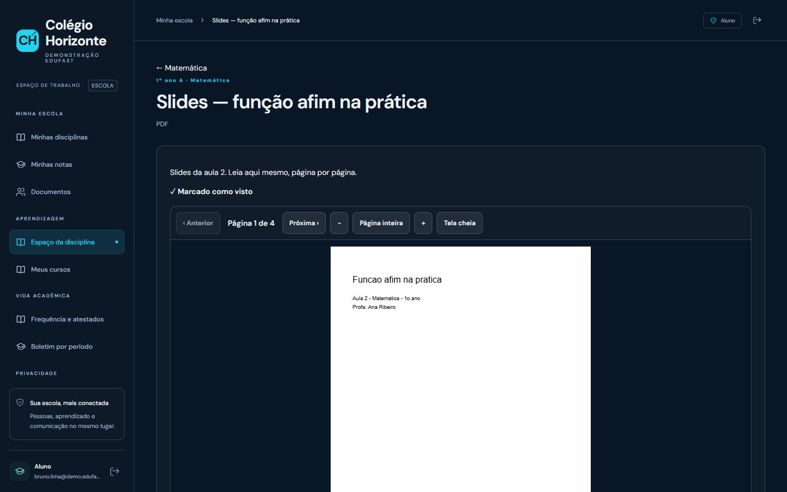
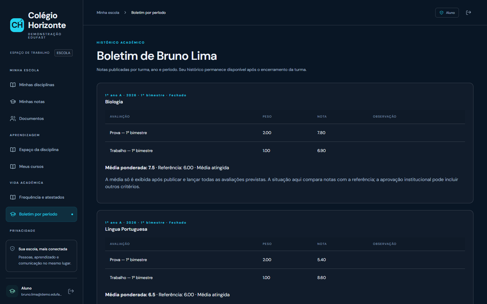
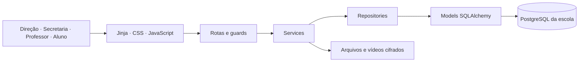
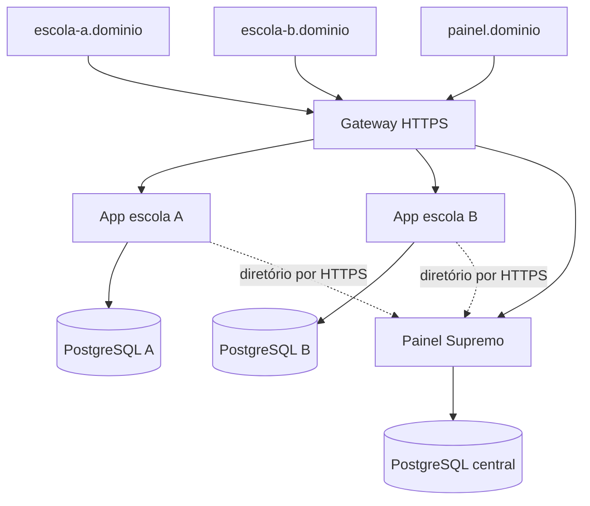

# EduFast 2.0

### Menos burocracia. Mais tempo para a educação.

[](https://github.com/Samucau1/edufast-2.0/actions/workflows/ci.yml)

O **EduFast** é uma plataforma de gestão escolar para o **ensino médio** que reúne a
secretaria, o professor e o aluno no mesmo lugar: turmas, chamada, notas, materiais de
estudo, cursos e comunicação. Ela foi feita para ser **simples de usar, leve em
computadores e celulares modestos, e segura**. Cada escola tem a própria instalação, os
próprios dados e a própria identidade visual.

<p align="center">
  
</p>

> Todas as telas desta página são capturas reais da versão atual, feitas em 25/11/2026 na
> escola de demonstração **Colégio Horizonte**, com dados fictícios.

[Experimente em um comando](#experimente) ·
[Tour pelas telas](#tour-pelas-telas) ·
[Funcionalidades](#funcionalidades) ·
[Situação e próximos passos](#situação-e-próximos-passos) ·
[Arquitetura](#arquitetura) ·
[Toda a documentação](Documentos/README.md)

## Por que EduFast

| | |
| --- | --- |
| **Um caminho por tarefa** | Cada tarefa tem uma tela só. Turma, matérias, professores e alunos ficam juntos, e as telas vazias dizem qual é o próximo passo. |
| **Implantação guiada** | A direção abre o sistema e encontra o checklist **Primeiros passos**: dos dados da escola até o primeiro acesso do aluno. |
| **A escola no controle** | Notas e materiais enviados pelo professor passam pela aprovação da secretaria. A avaliação inteira chega como **uma solicitação**, e a secretaria aprova várias de uma vez. |
| **Estudo dentro da plataforma** | PDF, slides, imagens e vídeos abrem num leitor próprio, sem baixar arquivos. O professor pode enviar vídeos de até 300 MB, guardados cifrados. |
| **Leve** | Não usa framework no navegador. Com as otimizações medidas, a frequência caiu de 172 para 16 consultas ao banco e o diário, de 422 para 53 KiB. |
| **Acessível** | 84 de 84 páginas aprovadas na auditoria automática de acessibilidade (axe-core), em desktop e celular. |
| **Seguro por padrão** | A autorização é conferida no banco a cada requisição. Há proteção contra CSRF e arquivos privados cifrados, e as migrations só rodam com revisão. |

## Experimente

Requisitos: Git, Docker com Docker Compose (no Windows, Docker Desktop aberto) e Node 20+.

```powershell
git clone https://github.com/Samucau1/edufast-2.0.git
cd edufast-2.0
node infra/demo-completa.cjs start
```

O comando sobe a escola completa em http://localhost:5095 e o painel Supremo em
http://127.0.0.1:5093/login. A escola vem com turma, três matérias, doze alunos, chamadas,
notas, boletim, materiais e o curso **Matemática para o ENEM**. Use
`node infra/demo-completa.cjs reset` para recomeçar do zero e `stop` para parar, mantendo os
dados.

| Perfil | E-mail | Senha |
| --- | --- | --- |
| Direção (super admin) | `diretoria@demo.edufast.test` | `Demo-EduFast-2026!` |
| Secretaria | `secretaria@demo.edufast.test` | `Demo-EduFast-2026!` |
| Professora de Matemática | `ana.ribeiro@demo.edufast.test` | `Demo-EduFast-2026!` |
| Aluno / aluna | `bruno.lima@demo.edufast.test` · `carla.souza@demo.edufast.test` | `Demo-EduFast-2026!` |
| Supremo (dono da plataforma) | `dono@plataforma.local` | `Plataforma-teste-2026!` |

Essas credenciais são **públicas e fictícias** e funcionam apenas no seu computador.
Nunca use essas credenciais em produção.

## Tour pelas telas

### Direção: implantação guiada

A Visão geral mostra o checklist **Primeiros passos**, que é calculado a partir dos dados da
própria escola. Na demonstração ele já está concluído: 8 de 8 passos.


### Secretaria: uma tela para cada turma

Em **Turmas** a secretaria cria a turma com o turno, registra cada matéria com o professor
(ou ainda sem professor) e matricula os alunos. Cada turma mostra as matérias, os
professores e os alunos no mesmo cartão.



### Professor: chamada e diário

A professora confirma a chamada da própria turma, e a frequência entra direto no
relatório. No diário, ela lança as notas da turma inteira numa tela só.





### Secretaria: aprovação em lote

As notas da avaliação chegam como **uma solicitação**. A secretaria vê aluno, nota atual e
nota enviada, e decide. Um filtro separa pendentes, decididas e todas, com o nome de quem
enviou.



### Aluno: disciplinas, materiais e boletim

O aluno vê as disciplinas com os professores e estuda os materiais no **leitor da
plataforma**, que passa página por página, tem zoom, tela cheia e marca o material como
visto. O boletim mostra a média ponderada de cada período.







### Cursos modulares

O curso se organiza em biblioteca, curso, módulos, capítulos e aulas. O aluno retoma de
onde parou. A aula pode trazer texto, materiais e a videoaula que a professora enviou, que
é guardada cifrada e assistida sem baixar.


### No celular

<p align="center">
  
  
  
</p>

### Painel Supremo: a plataforma inteira

O dono da plataforma acompanha as escolas, as pessoas sincronizadas e o resultado do mês
num painel com login e banco próprios. Ele não acessa notas nem documentos das escolas.


## Para quem

| Perfil | O que faz no sistema |
| --- | --- |
| Supremo (dono da plataforma) | Cadastra escolas e acompanha o diretório de pessoas e o financeiro da plataforma |
| Direção (super admin da escola) | Implantação guiada, identidade visual, usuários, papéis, calendário e políticas |
| Secretaria | Alunos, professores, turmas, matérias, matrículas, documentos e aprovação do que o professor envia |
| Professor | Chamada, diário de notas, materiais, abas da disciplina e cursos das turmas atribuídas |
| Professor revisor | Além do acima, aprova materiais de outros professores nas disciplinas atribuídas |
| Aluno | Disciplinas, materiais, cursos com retomada, frequência, boletim, documentos e solicitações |

Nenhum perfil da escola administra o Supremo, e a ordem da tabela não dá acesso automático
aos documentos restritos de outro perfil.

## Funcionalidades

| Módulo | O que inclui | Situação |
| --- | --- | --- |
| Acesso | Login, sessão, revogação, perfis, cadastro público sujeito a aprovação | Pronto |
| Secretaria | Alunos, professores, disciplinas e **tela única de Turmas** (turno, matéria com ou sem professor, matrículas, arquivamento) | Pronto |
| Implantação guiada | Checklist **Primeiros passos** e telas vazias com o próximo passo | Pronto |
| Aprovações | Solicitações com idempotência e decisão transacional; avaliação inteira numa solicitação; aprovação em lote; filtro e nomes | Pronto |
| Chamada e atestados | Professor confirma a chamada; correção versionada; atestados analisados pela secretaria | Pronto |
| Diário e boletim | Avaliações com peso, notas aprovadas, média ponderada por período | Pronto |
| Espaço da disciplina | Avisos, links, arquivos cifrados, abas do professor, progresso "visto" | Pronto |
| Leitor e vídeos | Leitor próprio de PDF e imagens, YouTube embutido sem cookies, envio de vídeo de até 300 MB cifrado em blocos | Pronto |
| Cursos modulares | Biblioteca, módulos, capítulos, aulas, materiais, publicação revisada, retomada e progresso | Pronto |
| Documentos e comunicação | Solicitações, envio e download autorizados, comunicados | Pronto |
| Identidade da escola | Nome, cores, tema, calendário, políticas e privacidade | Pronto |
| Instalações por escola | Geração e operação de instâncias isoladas, backup por escola | Testado em piloto sintético |
| Painel Supremo | Escolas, diretório de pessoas, receitas e despesas, auditoria | Pronto |
| Ensino superior | Ofertas de disciplina por período e inscrição individual | Modelo aprovado; implementação em seguida |
| RH, ponto, folha, financeiro escolar | Colaboradores, jornadas, competências, mensalidades | Planejado (protótipos) |

**Decisões de produto:**
- A chamada é confirmada direto pelo professor, sem aprovação.
- Um atestado aceito justifica a falta, mas não vira presença.
- Notas, materiais e a publicação de cursos passam pela aprovação da secretaria.

## Situação e próximos passos

**Novembro de 2026: beta funcional, pronto para um piloto controlado.**
- Validação: 393 testes automatizados passam em SQLite e em PostgreSQL 17. Os percursos de
  cada perfil foram verificados no navegador, em desktop e celular.
- Instalações reais: nenhuma instalação de produção foi homologada ainda.
- Banco de dados: as migrations 001 a 009 estão revisadas e aprovadas, mas só serão
  aplicadas num banco real na primeira implantação, com backup e plano de volta atrás.

| Próximo passo | Situação |
| --- | --- |
| Ensino superior: ofertas por período e inscrição do aluno | Modelo aprovado; a migration proposta 010 aguarda revisão |
| Passar a turma para o ano seguinte | Em discussão |
| Teste de usabilidade com pessoas reais (meta SUS ≥ 80) | Planejado |
| Guia curto do usuário e descrição da oferta | Planejado |
| RH, ponto, folha e financeiro escolar | Planejado; existem protótipos em [`Protótipo/`](Protótipo/) |

Planos:
- [plano de melhoria](Documentos/planejamento/PLANO_MELHORIA_2026-11-22.md);
- [plano de UX](Documentos/planejamento/PLANO_UX_2026-11-24.md);
- [estudo do ensino superior](Documentos/planejamento/ESTUDO_ENSINO_SUPERIOR_B4_2026-11-24.md);
- [roadmap](Documentos/planejamento/ROADMAP.md).

## Arquitetura

É um monólito **Flask** em camadas. As telas usam **Jinja, CSS com tokens e JavaScript
simples**, servidos pela própria aplicação, e os dados ficam em **PostgreSQL 17** via
SQLAlchemy.



**Uma instalação por escola.**
- Cada escola tem aplicação, banco, arquivos, contas, segredos e domínio próprios.
- Um gateway HTTPS encaminha cada domínio para a instalação certa.
- O **painel Supremo** (`Codigos/control_plane`) é outra aplicação, com banco próprio. Das
  escolas, ele recebe só o diretório de pessoas (nome, e-mail, perfil e situação), nunca
  senhas, notas ou documentos.



Toda entrega preserva estas garantias:
- autorização conferida no banco a cada requisição;
- proteção contra CSRF;
- idempotência;
- controle de versão contra edição simultânea;
- arquivos privados e cifrados;
- **nenhuma alteração de esquema ao iniciar**: as migrations ficam em `Codigos/migrations/`
  e só são aplicadas depois de revisadas.

Mais detalhes:
- [arquitetura](Documentos/arquitetura/ARQUITETURA.md);
- [instalações por escola](Documentos/planejamento/INSTANCIAS_POR_CLIENTE_2026-11-11.md);
- [painel Supremo](Documentos/planejamento/PAINEL_SUPREMO_2026-11-12.md);
- [permissões e aprovações](Documentos/seguranca-aprovacoes.md);
- [protocolo de design](Documentos/PROTOCOLO_DESIGN.md).

## Outros ambientes locais

| Ambiente | Comando | Endereço | Acesso |
| --- | --- | --- | --- |
| Demo completa (recomendada) | `node infra/demo-completa.cjs start` | http://localhost:5095 | veja [Experimente](#experimente) |
| Uma escola vazia para testes | `.\iniciar-educafast.ps1` | http://localhost:5050 | `superadmin@`, `admin@`, `professor@`, `aluno@teste.local` · `Teste-local-2026!` |
| Duas escolas (20 alunos, 5 professores cada) | `node infra/demo.cjs start` | http://127.0.0.1:5081 e :5082 | `admin@teste01.local`, `professor01@teste01.local`, `aluno01@teste01.local`… · `Teste-escolas-2026!` |

Sobre o `iniciar-educafast.ps1`:
- Ele aceita `-Porta`, `-SemNavegador`, `-Acao Status|Logs|Parar|CriarAdmin` e `-PrepararBancoNovo`.
- Ele cria o banco pelo esquema base só quando o banco está vazio, e nunca aplica migrations
  num banco existente.

**Instalação própria:**
1. Copie `Codigos/.env.example` para `Codigos/.env`.
2. Defina `SECRET_KEY` (32 ou mais caracteres), `DB_PASSWORD`, `POSTGRES_ADMIN_PASSWORD` e
   `DATA_ENCRYPTION_KEY` (o arquivo traz o comando que gera a chave; guarde-a junto do
   backup, porque sem ela os arquivos cifrados não podem ser lidos).
3. Revise o [procedimento de banco](Codigos/migrations/README.md).
4. Em `Codigos/`, execute:

   ```bash
   docker compose up -d --build
   docker compose exec app flask --app 'app:create_app()' create-admin
   ```

Para hospedar várias escolas:
- [infra/README.md](infra/README.md);
- [operação em nuvem](infra/CLOUD.md);
- [cadastro pelo operador](infra/PLATFORM.md);
- [guia de execução](Documentos/operacao/EXECUCAO.md).

## Testes e CI/CD

```bash
python .github/cicd/ci.py                                   # SQLite + PostgreSQL + imagem + HTTPS, ambiente descartável
python .github/cicd/run_cursos_backend.py --suite regressao # Regressão completa em PostgreSQL 17 descartável
node Codigos/tests/auditar_acessibilidade.cjs               # Acessibilidade (axe-core), 84 páginas
node Codigos/tests/verificar_demo_completa.cjs              # Demo completa pela interface, por perfil
python Codigos/tests/verificar_protocolo_design.py          # Protocolo visual
```

O que o CI faz:
- O workflow `ci.yml` roda a regressão, os fluxos HTTP por perfil, o painel Supremo em
  bancos descartáveis, a acessibilidade e o protocolo de design.
- Na `main` aprovada, ele publica a imagem testada.
- O `deploy.yml` é manual, via SSH, com backup antes.

Os relatórios de cada etapa ficam em [Documentos/testes](Documentos/testes/), e as capturas
datadas, em [Documentos/design/referencias](Documentos/design/referencias/).

## Tecnologias

| Camada | Tecnologias |
| --- | --- |
| Interface | HTML, Jinja, CSS com tokens, JavaScript simples, PDF.js local, fonte DM Sans local |
| Aplicação | Python 3.12, Flask 3.1, Gunicorn |
| Dados | SQLAlchemy 2.0, psycopg 3, PostgreSQL 17; `cryptography` para arquivos, vídeos e textos cifrados |
| Infraestrutura | Docker Compose, Nginx (instalações) e Caddy (instalação única), scripts Node |
| Testes | unittest, Node test runner, Playwright (Edge), axe-core, Postman/Newman, GitHub Actions |

## Estrutura do repositório

```text
├── Codigos/                  # Aplicação
│   ├── app/                  # routes, services, repositories, models, templates, static
│   ├── control_plane/        # Painel Supremo
│   ├── migrations/           # SQL 001–009 revisados, esquema base e propostas
│   ├── tests/                # Testes, verificadores de navegador e de design
│   └── demo/                 # Conteúdo fictício das demonstrações
├── infra/                    # Instalações por escola, demos e painel
├── Documentos/               # Arquitetura, planejamento, testes e design
├── Protótipo/                # Conceitos de RH, ponto e pagamentos
└── scripts/                  # Roteiros de demonstração e gravação
```

## Contribuir

Antes de alterar as telas, leia o [AGENTS.md](AGENTS.md) e o
[protocolo de design](Documentos/PROTOCOLO_DESIGN.md). Algumas regras:
- Preserve a autenticação, as aprovações e as garantias do banco.
- Migrations podem ser propostas, mas não executadas sem revisão.
- Não versione `.env`, bancos, uploads, chaves, caches ou logs, nem dados reais de alunos e
  colaboradores.

## Licença

Distribuído sob a [licença MIT](LICENSE), com os créditos originais preservados.
