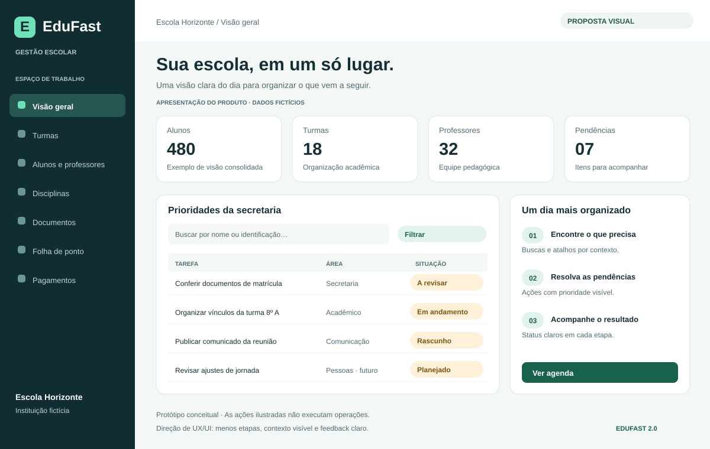
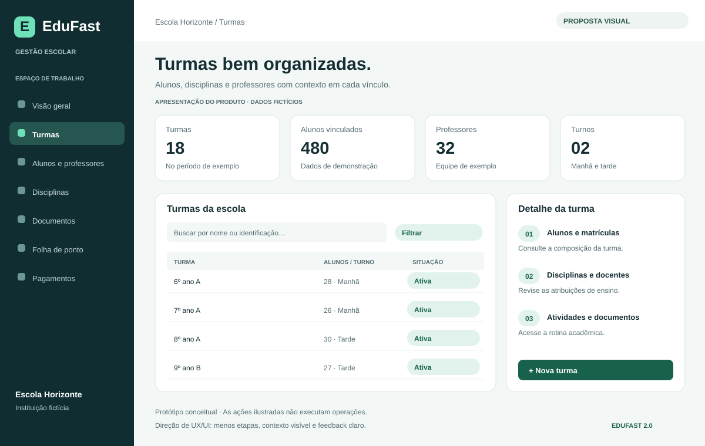
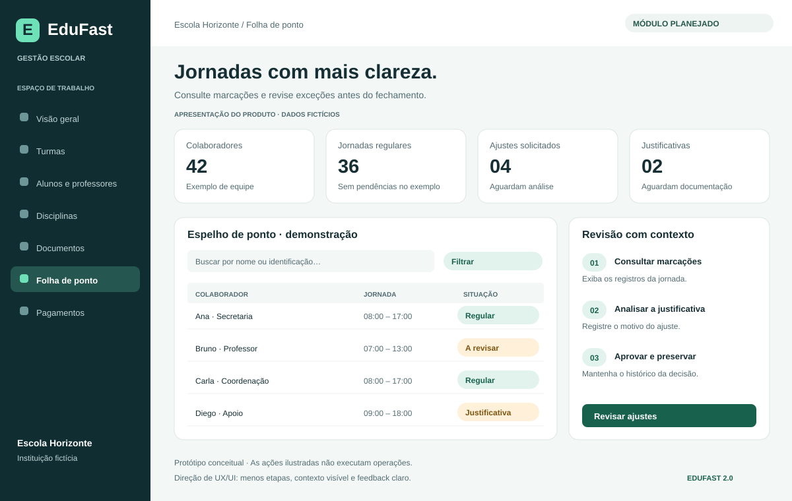
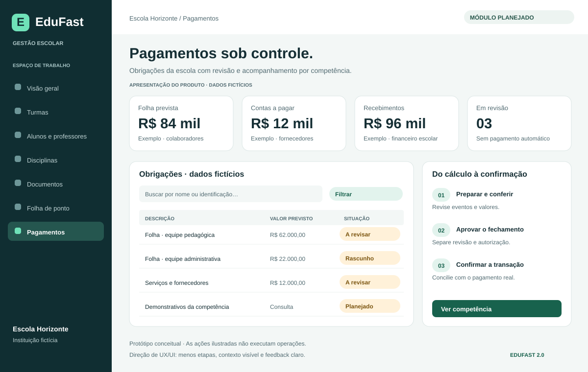
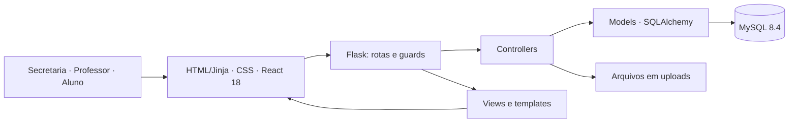

# EduFast 2.0

### Menos burocracia. Mais tempo para a educação.

O **EduFast** é um software de gestão escolar com foco em **agilidade, experiência do usuário e clareza visual**. A proposta é reunir a rotina acadêmica, administrativa e operacional em uma experiência integrada: do cadastro e da organização das turmas ao acompanhamento de pessoas, folha de ponto e pagamentos.

**Em desenvolvimento:** a base atual cobre processos acadêmicos e de secretaria. RH, ponto, folha de pagamento e financeiro são módulos planejados, apresentados aqui como protótipos.

[Arquitetura](Documentos/arquitetura/ARQUITETURA.md) · [Telas e UX/UI](Documentos/produto/TELAS_E_UX.md) · [Roadmap](Documentos/planejamento/ROADMAP.md) · [Execução](Documentos/operacao/EXECUCAO.md) · [Documentação](Documentos/README.md)

[](https://github.com/Samucau1/edufast-2.0/actions/workflows/ci.yml)

**CI/CD:** [configuração central e guia de produção](.github/cicd/README.md). Os workflows em `.github/workflows` executam testes isolados, publicam a mesma imagem validada e oferecem implantação manual por SSH após provisionamento do servidor.

## Por que o EduFast existe?

Escolas lidam diariamente com cadastros, turmas, documentos, notas, comunicação e rotinas de equipe. Quando as informações ficam espalhadas, tarefas simples exigem consultas repetidas e retrabalho.

O EduFast propõe uma central de trabalho organizada por perfil, com navegação consistente, informações contextualizadas e ações fáceis de encontrar. O objetivo é reduzir etapas nas tarefas recorrentes e mostrar o que precisa de atenção. Esses objetivos precisam ser medidos com usuários; não representam ganhos já comprovados.

## Para quem?

| Perfil | Experiência pretendida |
| --- | --- |
| Direção | Acompanhar a operação com informações reunidas |
| Secretaria | Organizar alunos, professores, turmas, vínculos e documentos |
| Professor | Consultar sua rotina, lançar atividades e registrar notas |
| Aluno | Acompanhar disciplinas, atividades, notas e solicitações |
| RH e financeiro — planejados | Administrar colaboradores, ponto, folha e pagamentos |

## Funcionalidades

“Presente” indica funcionalidade identificada no código deste repositório, sem representar homologação de produção.

| Módulo | Escopo | Situação |
| --- | --- | --- |
| Acesso | Login, sessão web, JWT e verificações por perfil | Presente |
| Secretaria | Cadastro e detalhes de alunos e professores | Presente |
| Organização acadêmica | Criação de turmas e disciplinas; vínculos acadêmicos | Presente |
| Professor | Painel, lançamento de atividades e notas | Presente |
| Aluno | Painel e consulta de disciplinas | Presente |
| Documentos | Solicitações, envio e download de arquivos | Presente |
| Comunicação | Cadastro e consulta de comunicados | Presente |
| Cursos | Capítulos, temas, videoaulas e progresso | Planejado |
| Gestão de pessoas | Colaboradores, cargos, contratos e jornadas | Planejado |
| Folha de ponto | Marcações, justificativas, ajustes e aprovação | Planejado |
| Folha de pagamento | Competências, eventos, revisão e fechamento | Planejado |
| Financeiro escolar | Mensalidades, contas, recebimentos e conciliação | Planejado |
| Gestão completa | Integração dos módulos e relatórios consolidados | Visão de evolução |

## Apresentação visual

As imagens são **protótipos conceituais com dados fictícios**. Não são capturas do sistema atual nem módulos conectados ao banco. As telas existentes estão no [catálogo de telas](Documentos/produto/TELAS_E_UX.md).

### Visão geral da escola

Indicadores, tarefas e atalhos para começar a rotina.



### Turmas e organização acadêmica

Busca, contexto da turma e acesso aos vínculos acadêmicos no mesmo espaço.



### Pessoas e folha de ponto — planejado

Jornadas e pendências para revisão e aprovação.



### Pagamentos — planejado

Separação entre folha de colaboradores e recebimentos da escola, com estados de revisão explícitos.



Veja as decisões de interação, acessibilidade e novas telas no [guia de UX/UI](Documentos/produto/TELAS_E_UX.md).

## Arquitetura

A aplicação é um **monólito Flask organizado em camadas**, com páginas HTML renderizadas por Jinja, componentes React via CDN e persistência SQLAlchemy/MySQL.



O modelo atual inclui usuários, alunos, professores, turmas, disciplinas, vínculos, notas, atividades, comunicados e documentos. A evolução prevê serviços de aplicação para cursos, RH, ponto e financeiro, acompanhados de migrações versionadas. Esses serviços e entidades futuras ainda não estão implementados.

O [documento de arquitetura](Documentos/arquitetura/ARQUITETURA.md) detalha responsabilidades, dados, fluxo de requisições, implantação e limitações.

## Estrutura do repositório

```text
Teste-de-software/
├── .github/
│   ├── workflows/                # Entradas obrigatórias do GitHub Actions
│   └── cicd/                     # CI/CD, testes e configuração de produção
├── Códigos/                       # Aplicação executável
│   ├── app/
│   │   ├── controllers/           # Operações da aplicação
│   │   ├── models/                # Entidades e persistência
│   │   ├── routes/                # Rotas e guards
│   │   ├── views/                 # Renderização
│   │   ├── templates/             # HTML/Jinja
│   │   └── static/                # CSS e JavaScript
│   ├── app.py                     # Entrada Flask
│   ├── config.py                  # Configuração por ambiente
│   ├── .env.example
│   ├── Dockerfile
│   ├── docker-compose.yml
│   └── requirements.txt
├── Documentos/
│   ├── arquitetura/
│   ├── produto/                   # UX/UI e catálogo de telas
│   ├── operacao/                  # Instalação e manutenção local
│   ├── planejamento/              # Roadmap e plano anterior
│   ├── testes/logs-historicos/     # Evidências preservadas
│   └── arquivo/ci2/               # Pacote histórico de outra base
├── Protótipo/
│   ├── edufast/                   # Prévias SVG da proposta visual
│   └── legado/                    # Dashboard HTML anterior
├── scripts/                       # Gerador de protótipos e utilitários históricos em legado/
├── iniciar-educafast.ps1           # Atalho Docker local
├── README.md
└── LICENSE
```

Os PDFs e DOCX originais foram preservados em `Documentos/`. O pacote `arquivo/ci2` mantém relatórios históricos de outra base. A automação antiga foi substituída pelo CI/CD ativo em `.github/`.

## Executar localmente

Requisitos: Git e Docker com Docker Compose. No Windows, mantenha o Docker Desktop em execução.

```powershell
git clone https://github.com/Samucau1/edufast-2.0.git
cd edufast-2.0
Copy-Item 'Códigos/.env.example' 'Códigos/.env'
```

Edite `Códigos/.env` e configure `SECRET_KEY`, `DB_PASSWORD` e `MYSQL_ROOT_PASSWORD`. Depois:

```powershell
.\iniciar-educafast.ps1 -SemNavegador
```

Ou, em qualquer sistema com Docker:

```bash
cd Códigos
docker compose up -d --build
docker compose logs -f app
```

Acesse **http://localhost:5000** após a inicialização. A aplicação usa a porta 5000; o MySQL é publicado na porta 3306.

**Administrador em instalação descartável:** `docker compose exec app python -m app.seed` cria `admin@admin.com` com senha `123`, mas o seed atual **apaga todos os usuários existentes**. Use apenas em banco novo de desenvolvimento e altere a senha antes de qualquer exposição. Não execute para atualizar uma escola cadastrada.

Mais comandos, configuração e solução de problemas: [guia de execução](Documentos/operacao/EXECUCAO.md).

## Tecnologias

| Camada | Tecnologias |
| --- | --- |
| Interface | HTML, Jinja, CSS, JavaScript, React 18 via CDN e Tailwind em templates |
| Aplicação | Python e Flask 3.1 |
| Dados | SQLAlchemy 2.0, PyMySQL e MySQL 8.4 |
| Ambiente | Docker, Docker Compose e variáveis de ambiente |
| Autenticação | Sessão Flask e JWT HS256 implementado na aplicação |

## Próximos passos

1. Validar os fluxos existentes e estabelecer testes reproduzíveis para esta base.
2. Consolidar a identidade EduFast e avaliar os protótipos com os usuários.
3. Evoluir vínculos docentes e registros acadêmicos por período.
4. Implementar RH e ponto com revisão e trilha de alterações.
5. Evoluir folha e financeiro com regras configuráveis e validação especializada.

O [roadmap](Documentos/planejamento/ROADMAP.md) detalha dependências e critérios de entrega. Logs arquivados são históricos; os testes atuais estão em `.github/cicd/` e os resultados remotos na aba Actions.

## Contribuir

Abra uma issue com o problema, perfil afetado, resultado esperado e passos para reproduzir. Em alterações de código, documente o impacto e valide o fluxo envolvido. Não inclua `.env`, senhas, bancos ou documentos reais de alunos e colaboradores em commits. Preserve a identificação de protótipo nas telas sem implementação.

## Licença

Distribuído sob a [licença MIT](LICENSE), com os créditos originais preservados.
