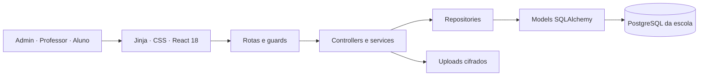
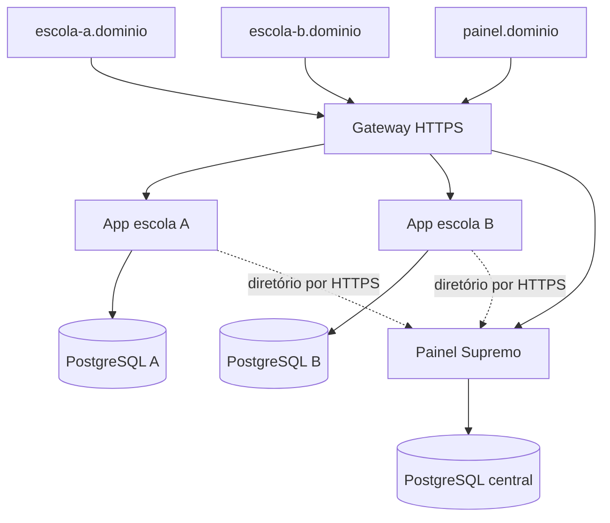

# EduFast 2.0

### Menos burocracia. Mais tempo para a educação.

[](https://github.com/Samucau1/edufast-2.0/actions/workflows/ci.yml)

O **EduFast** (EducaFast) é um software de gestão escolar com foco em **agilidade,
usabilidade e baixo consumo de hardware**. A primeira versão comercial mira o
**ensino médio e o ensino superior**: turmas, chamada confirmada pelo professor,
espaço da disciplina com avisos e materiais, abas docentes e cursos modulares,
sobre uma base de secretaria, aprovações, documentos e comunicação.

**Estado atual (novembro de 2026):** produto em preparação para apresentação e
venda, demonstrável localmente com dados fictícios. A implantação em servidor será
feita quando houver cliente. Nenhuma instalação de produção foi homologada.

[Arquitetura](Documentos/arquitetura/ARQUITETURA.md) ·
[Preparação para entrega](Documentos/planejamento/PREPARACAO_ENTREGA_2026-11-16.md) ·
[Plano ensino médio/superior](Documentos/planejamento/ENSINO_MEDIO_SUPERIOR_2026-11-16.md) ·
[Execução](Documentos/operacao/EXECUCAO.md) ·
[Protocolo de design](Documentos/PROTOCOLO_DESIGN.md) ·
[Toda a documentação](Documentos/README.md)

## Para quem?

| Perfil | O que faz no sistema |
| --- | --- |
| Supremo (proprietário da plataforma) | Cadastra escolas, consulta o diretório de pessoas e o financeiro da plataforma, em painel e banco próprios |
| Superadmin da escola | Identidade visual, usuários, papéis, calendário e políticas da própria escola |
| Admin / secretaria | Cadastros, turmas, disciplinas, vínculos, documentos e aprovação de propostas |
| Professor | Turmas e disciplinas atribuídas: chamada, materiais, abas, cursos, atividades e notas no diário da avaliação (cada lançamento aprovado pela secretaria) |
| Professor revisor | Além do acima, aprova materiais de outros professores nas disciplinas que lhe foram atribuídas |
| Aluno | Disciplinas, materiais, cursos com retomada, presença, documentos e solicitações próprias |

A ordem indica responsabilidade e alcance. Ela não concede acesso automático a
documentos restritos de outros perfis, e nenhum perfil escolar administra o Supremo.

## Funcionalidades

**Situação** distingue código presente, testes aprovados e ativação. Módulos marcados
com migration dependem de SQL **ainda pendente de revisão**: sem as tabelas, o
módulo responde 503 e o restante da aplicação continua funcionando.

| Módulo | Escopo | Situação |
| --- | --- | --- |
| Acesso | Login, sessão, JWT, revogação, restrições por perfil, cadastro público pendente de aprovação | Presente |
| Secretaria | Alunos, professores, turmas, disciplinas e vínculos | Presente |
| Aprovações | Propostas docentes com idempotência, decisão transacional, conflito em segunda decisão | Presente (migration 002) |
| Documentos e comunicação | Solicitações, envio/download autorizado, comunicados | Presente |
| Identidade e gestão escolar | Nome, cores, tema, calendário, políticas, diário/boletim, privacidade | Presente (migration 003) |
| Chamada — MS01 | Professor confirma a chamada da própria oferta; correção versionada; atestados com análise administrativa | CI SQLite/MySQL aprovado em 19/11; regressão em PostgreSQL em 22/11 (migration 004) |
| Espaço da disciplina — MS02 | Avisos, links e arquivos de estudo cifrados por turma/disciplina | CI aprovado (migration 005) |
| Abas docentes — MS03 | Criar, renomear, ordenar e arquivar seções, preservando histórico | CI aprovado (migration 006) |
| Cursos modulares — MS04 | Biblioteca → curso → módulos → capítulos → aulas de texto ou vídeo, materiais, publicação revisada, retomada e progresso | Implementado; demo ENEM; aceite manual pendente (migration 007) |
| Instalações por escola | Geração e operação de instâncias isoladas, backup por cliente | Testes de configuração e piloto sintético no CI |
| Painel Supremo | Login exclusivo, escolas, diretório de pessoas, receitas/despesas manuais, auditoria | Implementado; banco central pendente de revisão |
| Usabilidade e desempenho — MS05 | Jornadas completas, desktop/mobile, consultas e recursos | A fazer |
| RH, ponto, folha, financeiro escolar | Colaboradores, jornadas, competências, mensalidades | Planejado (somente protótipos) |

**Decisões de produto:** a chamada é confirmada diretamente pelo professor, sem
aprovação; chamadas antigas pendentes não são convertidas. Atestado aceito justifica
a falta, mas não vira presença. Materiais, notas e publicação de cursos continuam
passando pelo fluxo de aprovação.

## Arquitetura

Monólito **Flask** em camadas, com frontend **Jinja + CSS + React 18 local** servido
pela própria aplicação e persistência **SQLAlchemy/PostgreSQL 17**.



**Uma instalação por escola.** Cada cliente tem aplicação, PostgreSQL, uploads, contas,
segredos e domínio próprios. Um gateway HTTPS encaminha cada domínio à instância
correta. O **painel Supremo** (`Codigos/control_plane`) é outra aplicação Flask, com
banco central próprio, e recebe das escolas apenas o diretório de pessoas
(nome, e-mail, perfil e situação), sem senhas, notas ou documentos.



Garantias preservadas em todas as entregas: autorização conferida no banco a cada
requisição, CSRF, idempotência, controle de versão contra edição concorrente,
arquivos privados e cifrados, e **nenhuma DDL executada ao iniciar**. Migrations
são propostas versionadas em `Codigos/migrations/` e só são aplicadas após revisão.

Detalhes: [arquitetura](Documentos/arquitetura/ARQUITETURA.md),
[instâncias por cliente](Documentos/planejamento/INSTANCIAS_POR_CLIENTE_2026-11-11.md),
[painel Supremo](Documentos/planejamento/PAINEL_SUPREMO_2026-11-12.md) e
[permissões e aprovações](Documentos/seguranca-aprovacoes.md).

## Estrutura do repositório

```text
Teste-de-software/
├── .github/
│   ├── workflows/            # ci, cloud-instances, deploy (manual), tdd
│   └── cicd/                 # Executor do CI, imagem, produção, testes HTTP/Postman
├── Codigos/                  # Aplicação
│   ├── app/
│   │   ├── routes/           # Rotas e guards
│   │   ├── controllers/      # Operações legadas da aplicação
│   │   ├── services/         # Regras de negócio (inclui cursos_ms04/)
│   │   ├── repositories/     # Consultas
│   │   ├── models/           # Entidades SQLAlchemy
│   │   ├── templates/        # Jinja e parciais workspace_*
│   │   └── static/           # design_system.css, app.css, escola.css, JS
│   ├── control_plane/        # Painel Supremo (aplicação e banco central)
│   ├── migrations/           # SQL 001–007 propostos, pendentes de revisão
│   ├── tests/                # Verificadores de navegador e de protocolo de design
│   └── demo/                 # Conteúdo fictício da demonstração ENEM
├── infra/                    # Geração/operação de instâncias, demos e painel
├── Documentos/               # Arquitetura, planejamento, testes, design
├── Protótipo/                # SVGs conceituais (RH, ponto, pagamentos)
├── scripts/
├── iniciar-educafast.ps1     # Uma escola local (Windows)
└── iniciar-duas-escolas.ps1  # Teste 01 e Teste 02 (Windows)
```

## Executar localmente

Requisitos: Git e Docker com Docker Compose (no Windows, Docker Desktop aberto).
As demos de várias escolas e do painel também exigem **Node 20+**.

```powershell
git clone https://github.com/Samucau1/edufast-2.0.git
cd edufast-2.0
```

Todas as credenciais abaixo são **públicas, fictícias e restritas ao loopback**.
Nunca as use em produção.

| Ambiente | Comando | Endereço | Acesso |
| --- | --- | --- | --- |
| Uma escola | `.\iniciar-educafast.ps1` | http://localhost:5050 | `superadmin@`, `admin@`, `professor@`, `aluno@teste.local` · `Teste-local-2026!` |
| Duas escolas (20 alunos, 5 professores, 3 matérias cada) | `.\iniciar-duas-escolas.ps1` ou `node infra/demo.cjs start` | http://127.0.0.1:5081 e :5082 | `admin@teste01.local`, `professor01@teste01.local`, `aluno01@teste01.local`… · `Teste-escolas-2026!` |
| Cursos — demo Matemática ENEM | `node infra/enem-demo.cjs start` | http://127.0.0.1:5092 | `aluno02@`, `professor01@`, `admin@teste01.local` · `Teste-escolas-2026!` |
| Painel Supremo | `node infra/platform-demo.cjs start` | http://127.0.0.1:5093/login | `dono@plataforma.local` · `Plataforma-teste-2026!` |

- `iniciar-educafast.ps1` aceita `-Porta`, `-SemNavegador`, `-Acao Status|Logs|Parar|CriarAdmin`
  e `-PrepararBancoNovo`. Ele cria o banco pelo esquema base (`migrations/base/`) apenas quando está vazio, e nunca
  aplica migrations em banco existente.
- As demos ENEM e Supremo usam bancos temporários: **parar descarta os dados**.
- Roteiros: [duas escolas](Documentos/testes/DUAS_ESCOLAS_TESTE_2026-11-11.md),
  [cursos ENEM](Documentos/testes/FRONTEND_CURSOS_MS04_2026-11-20.md) e
  [painel Supremo](Documentos/planejamento/PAINEL_SUPREMO_2026-11-12.md).

**Instalação própria:** copie `Codigos/.env.example` para `Codigos/.env`, defina
`SECRET_KEY` (32+ caracteres), `DB_PASSWORD` e `POSTGRES_ADMIN_PASSWORD`, revise o
[procedimento de banco](Codigos/migrations/README.md) e execute em `Codigos/`:

```bash
docker compose up -d --build
docker compose exec app flask --app 'app:create_app()' create-admin
```

Hospedagem com várias escolas: [infra/README.md](infra/README.md),
[operação em nuvem](infra/CLOUD.md) e [cadastro pelo operador](infra/PLATFORM.md).
Mais comandos e solução de problemas: [guia de execução](Documentos/operacao/EXECUCAO.md).

## Testes e CI/CD

```bash
python .github/cicd/ci.py                                   # SQLite + PostgreSQL + imagem + HTTPS, ambiente descartável
python .github/cicd/run_cursos_backend.py --suite regressao # Regressão e MS04 em containers isolados
node --test infra/test_*.cjs                                # Geração, operação e cadastro de instâncias
python Codigos/tests/verificar_protocolo_design.py          # Protocolo visual
```

O workflow `ci.yml` executa a regressão, os fluxos HTTP por perfil, o painel
Supremo em bancos descartáveis e o protocolo de design. Na `main` aprovada, publica
a imagem testada por digest. `deploy.yml` é manual, via SSH, com backup prévio.
`tdd.yml` roda contratos de versões futuras que permanecem falhando de propósito.
Detalhes em [.github/cicd/README.md](.github/cicd/README.md); relatórios datados em
[Documentos/testes](Documentos/testes/).

Os testes criam esquemas novos e descartáveis. **Nenhuma migration foi executada
em banco persistente.**

## Tecnologias

| Camada | Tecnologias |
| --- | --- |
| Interface | HTML, Jinja, CSS com tokens, JavaScript, React 18 local, fonte DM Sans local |
| Aplicação | Python 3.12, Flask 3.1, Gunicorn |
| Dados | SQLAlchemy 2.0, psycopg 3, PostgreSQL 17; `cryptography` para arquivos e textos cifrados |
| Infraestrutura | Docker Compose, Nginx (instâncias) e Caddy (instalação única), scripts Node |
| Testes | unittest, Node test runner, Playwright, Postman/Newman, GitHub Actions |

## Próximos passos

1. **MS04:** revisar a migration 007 e concluir o teste manual da demo de cursos.
2. **MS05:** revisar usabilidade e desempenho das jornadas completas em desktop e celular.
3. Revisar e ativar as migrations 002–007 e o banco central, com backup e ensaio.
4. Ensaiar backup e restauração por escola e do painel central em ambiente isolado.
5. Fechar a versão demonstrável: roteiro comercial, guia curto e limitações conhecidas.
6. Evoluções futuras: matrícula por disciplina no superior, RH, ponto, folha e financeiro escolar.

Backlog completo: [preparação para entrega](Documentos/planejamento/PREPARACAO_ENTREGA_2026-11-16.md)
e [roadmap](Documentos/planejamento/ROADMAP.md).

## Contribuir

Leia o [AGENTS.md](AGENTS.md) e o [protocolo de design](Documentos/PROTOCOLO_DESIGN.md)
antes de alterar interfaces. Preserve a autenticação, as aprovações e as garantias do
banco. Migrations podem ser propostas, mas não executadas sem revisão. Não versione
`.env`, bancos, uploads, chaves, caches ou logs, nem dados reais de alunos e colaboradores.

## Licença

Distribuído sob a [licença MIT](LICENSE), com os créditos originais preservados.
