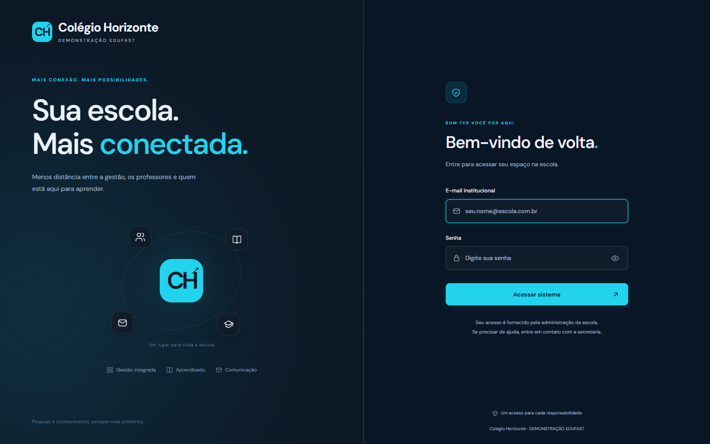
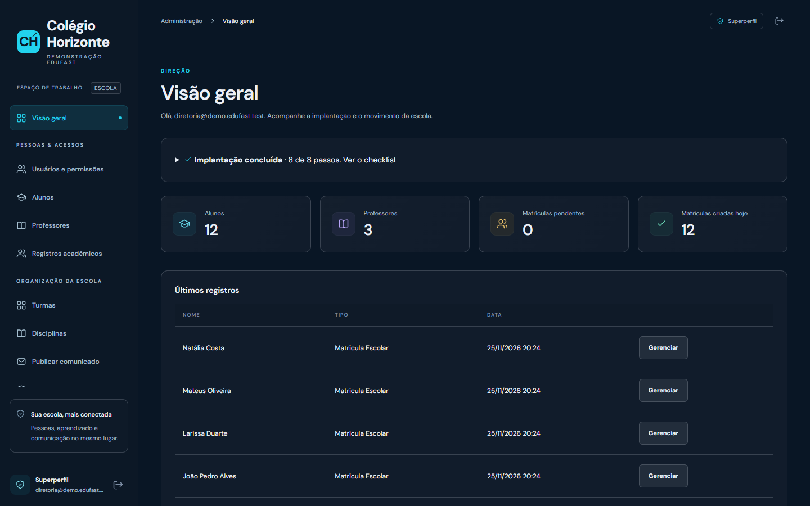
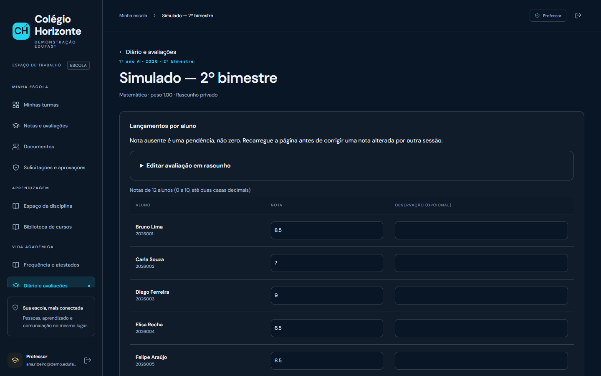

# Educa Fast

## Integrantes

| Nome completo | Matrícula | Turma |
| --- | --- | --- |
| Pedro Henrique Moreira Sobreira | UC23200607 | GPE17M80081 |
| Roberto Qiming Li | UC23101571 | GPE17M80081 |
| Samuel Galvão Fernandes | UC23101483 | GPE17M80081 |
| Vittor Kawe Araujo Sousa | UC23101551 | GPE17M80081 |
| Yago Coutinho de Oliveira | UC23200421 | GPE17M80081 |

## Vídeo de apresentação

[Assistir no YouTube](https://www.youtube.com/watch?v=YIObY_EzHO8)

## Prints da solução

### Tela de login

### Painel inicial do superadministrador

### Diário e avaliações do professor

## Documentação

| Documento | Conteúdo |
| --- | --- |
| [BMC.pdf](BMC.pdf) · [BMC.md](BMC.md) | Business Model Canvas (canvas visual e texto) |
| [DADOS.pdf](DADOS.pdf) | Modelo de dados: diagrama ER e dicionário ([editável](dados/modelo-dados.dot)) |
| [INDICE.md](INDICE.md) | Índice de toda a documentação (arquitetura, casos de uso, UX/UI, testes, planejamento) |
| [../api/README.md](../api/README.md) | Instalação e execução da API |
| [../web/README.md](../web/README.md) | Acesso à aplicação web |
