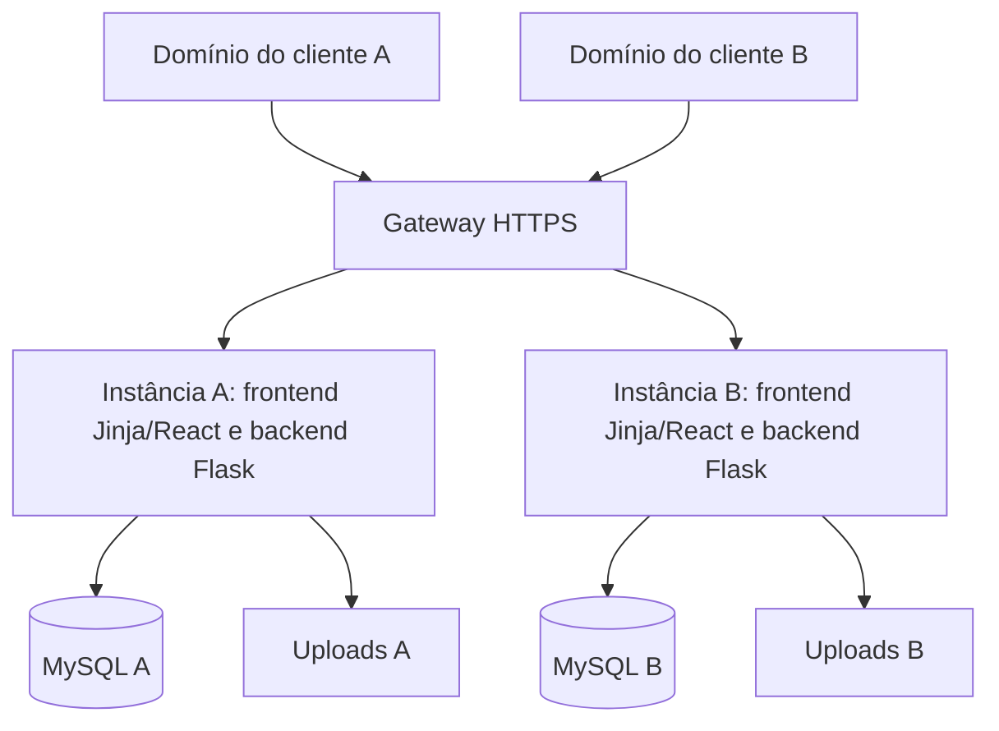

# Instâncias por cliente — mapeamento e plano de aplicação

Data: 11/11/2026. Base inspecionada: `1a9353776dea756ec3ffb125b1bd02279d35ea5c`, com alterações locais preexistentes em contratos e testes da próxima versão, preservadas.

Estado: proposta de arquitetura e backlog. Este documento não ativa ambientes, não altera autenticação e não autoriza executar migrations. O pedido é mapear a separação de banco, backend e frontend por cliente e as ações necessárias para aplicá-la.

**Direção confirmada pelo usuário em 11/11/2026:** hospedagem em servidor de nuvem, com containers próprios e acesso próprio para cada cliente. A escolha de provedor, capacidade e domínio permanece pendente. A organização técnica inicial abaixo mantém frontend/backend juntos no container da aplicação e MySQL em outro container exclusivo do cliente.

**Implementação iniciada em 11/11/2026:** `infra/manage.cjs` prepara revisões sem sobrescrita, preserva segredos e volumes, fixa release por cliente, oferece operações dirigidas a um cliente e backup com pausa/retomada da aplicação. O [guia de nuvem](../../infra/CLOUD.md) documenta uso e limitações. Há testes de configuração/operação e piloto sintético incluído no CI; a disponibilização em nuvem, a restauração ensaiada e o aceite de produção continuam pendentes. Nenhuma migration foi executada por esta implementação.

## 1. Resultado pretendido

Cada cliente deve acessar seu próprio endereço e usar sua própria instalação da aplicação, com MySQL, arquivos, contas, segredos, configurações e recuperação independentes. Uma mesma versão do código pode atender vários clientes por meio de instâncias distintas, evitando manter uma cópia divergente do projeto para cada um.

Hipótese inicial para organizar o piloto: **um cliente = uma escola = uma instalação**. Se um cliente representar várias escolas, será necessário definir se cada escola terá instalação própria ou se haverá regras institucionais dentro da instalação. Esse segundo caso exige um projeto adicional de autorização e dados; a separação de containers não o resolve.

| Termo | Significado neste plano |
| --- | --- |
| Cliente | Contratante que possui a instalação |
| Escola | Instituição atendida; inicialmente uma por cliente |
| Instância | Processos, configuração e armazenamento destinados ao cliente |
| Release | Versão imutável da aplicação, identificada pelo digest da imagem |
| Gateway | Entrada HTTPS que encaminha o domínio para a aplicação correta |

## 2. O que o repositório já oferece

| Área | Evidência | Situação e ação necessária |
| --- | --- | --- |
| Backend | `api/app/__init__.py`, `api/gunicorn.conf.py` | Flask/Gunicorn; pode ser executado por cliente |
| Frontend | `api/app/templates/`, `api/app/static/` | HTML/Jinja e componentes React locais, servidos pelo Flask; não existe aplicação frontend autônoma |
| Banco | `api/config.py`, `api/app/database.py` | Uma engine configurada por processo; combina com banco fixo por instalação, sem selecionar conexão pelo navegador |
| Geração | `infra/generate.cjs`, `infra/environments.example.json` | Gera app, MySQL, duas redes, volumes e quatro segredos por escola |
| Entrada HTTPS | Nginx gerado por `infra/generate.cjs` | Encaminhamento por domínio, rejeição de host desconhecido e limites; TLS precisa ser disponibilizado e renovado operacionalmente |
| Persistência | Serviços gerados em `infra/generate.cjs` | Volume MySQL e volume de uploads próprios; falta comprovar backup/restauração por cliente em execução |
| Autenticação | `api/app/auth.py`, `api/config.py` | JWT usa `SECRET_KEY`; preservar chaves diferentes e verificar rejeição cruzada de tokens e sessões |
| Esquema | `api/app/database.py`, `api/migrations/README.md` | Inicialização em produção verifica esquema; provisionamento é explícito e exige revisão |
| Entrega | `.github/cicd/`, `infra/README.md` | Deploy existente é de instalação única; falta entrega operacional dirigida a um cliente da frota |

No gerador, `front-escola-a` é o **nome de uma rede**, não um container de frontend. Os nomes `DB_NAME=edufast` e `DB_USER=edufast` se repetem em servidores MySQL distintos; essa repetição não compartilha banco, desde que destino, rede, volume e senha permaneçam separados.

O Compose direto de `api/docker-compose.yml` possui nomes fixos de containers e portas locais. Não deve ser multiplicado sem adaptação; a base de separação é `infra/`.

## 3. Arquitetura proposta



**Etapa inicial proposta:** entregar um frontend próprio por cliente através de sua instância Flask. Isso preserva o modo atual de renderização e o design. Backend e frontend continuam no mesmo container de cada cliente, com domínio e configuração próprios.

**Se “frontend próprio” exigir um serviço separado:** incluir uma etapa específica de separação. Um Nginx por cliente pode servir assets públicos e encaminhar páginas Jinja e chamadas ao backend do mesmo cliente, preservando uma única origem. As páginas Jinja continuam sendo renderizadas no backend. Uma aplicação frontend totalmente autônoma exige inventariar e completar APIs, formulários, CSRF, sessão, erros, uploads e navegação, além de testes de equivalência. Essa reescrita não está incluída na etapa inicial e precisa ser uma decisão explícita de escopo.

Gateway e máquina podem ser compartilhados no piloto. Nesse modelo, falha de host, disco ou gateway pode afetar todos os clientes. Exigência de sistema operacional, capacidade ou disponibilidade exclusivos leva a VM/host por cliente. Containers e redes não fornecem essa garantia.

### Aplicação da decisão de hospedagem em nuvem

Modelo inicial: uma VM Linux na nuvem executa Docker Compose, um gateway HTTPS comum e um conjunto de containers para cada cliente. Usar dois containers por cliente: `app-cliente-a` (frontend e backend) e `db-cliente-a` (MySQL). Banco e aplicação têm ciclos de vida diferentes e não serão reunidos em um único container.

| Item | Cliente A | Cliente B |
| --- | --- | --- |
| Acesso pelo navegador, exemplo | `https://cliente-a.seudominio.com` | `https://cliente-b.seudominio.com` |
| Aplicação | `app-cliente-a` | `app-cliente-b` |
| MySQL | `db-cliente-a` | `db-cliente-b` |
| Dados persistentes | Volumes exclusivos de banco e uploads | Volumes exclusivos de banco e uploads |
| Login | Contas e permissões locais | Contas e permissões locais |
| Segredos | Chaves e senhas exclusivas | Chaves e senhas exclusivas |

Os endereços acima são ilustrativos. Os subdomínios podem apontar para o mesmo IP público; o gateway seleciona a aplicação pelo domínio. Não é necessário um IP público por cliente. O acesso do cliente significa usar o sistema e seu administrador local no navegador; acesso SSH, painel Docker ou senha de root do banco não é concedido por esse modelo.

Preparação da nuvem, antes do piloto:

1. Selecionar provedor, região e VM Linux, considerando orçamento, usuários simultâneos, armazenamento e recuperação. Dimensionamento depende de medição; a quantidade de clientes, isoladamente, não define a máquina.
2. Reservar endereço público estável, configurar DNS e certificados válidos para os domínios. Definir renovação automática dos certificados e monitorar falhas; isso ainda não está automatizado na base atual.
3. Configurar firewall da nuvem e do host: entrada pública HTTPS no gateway; HTTP somente se usado para redirecionamento/emissão de certificado; administração por origem restrita ou VPN. Não publicar MySQL nem a API Docker na internet.
4. Manter app e MySQL em redes privadas por cliente e dados em volumes persistentes. Guardar segredos fora do Git e preservar as chaves nas atualizações.
5. Configurar backups protegidos fora da VM, incluindo banco/uploads consistentes e recuperação das chaves por procedimento restrito; testar restauração antes de receber dados reais.
6. Aplicar limites de recursos, monitoramento, alertas de disco e procedimento de atualização por cliente. Falha da VM continua sendo uma falha compartilhada.
7. Executar o piloto com duas instalações sintéticas e a matriz de aceite deste documento. Somente depois disponibilizar clientes reais.

Começar com a base Compose existente; Kubernetes e reescrita do frontend não são requisitos desta decisão. A documentação oficial descreve [Compose em produção em servidor único](https://docs.docker.com/compose/how-tos/production/); as limitações de isolamento devem ser consideradas conforme a [segurança do Docker Engine](https://docs.docker.com/engine/security/).

## 4. Contrato de isolamento

| Recurso | Regra exigida |
| --- | --- |
| Domínio | Um domínio validado aponta para uma instalação; host desconhecido é rejeitado |
| Backend | Processo próprio, conexão fixa com seu MySQL e nenhuma credencial de outro cliente |
| Frontend | Páginas e assets da release da instalação; personalização usa tokens validados pelo servidor |
| Banco | Servidor/container e volume próprios; acesso apenas pela rede do backend correspondente e manutenção controlada |
| Credenciais | Senhas MySQL, chave de sessão/JWT e chave de criptografia próprias; nunca regenerar na atualização |
| Contas | Contas e papéis locais; um mesmo email pode existir independentemente em instalações diferentes |
| Sessão | Cookie restrito ao host, HTTPS e rejeição de sessão/token de outro cliente |
| Arquivos | Volume próprio; upload e download preservam autorização, propriedade e aprovações |
| Operação | Toda atualização, backup, restauração e suspensão identifica explicitamente o cliente |
| Suporte | Operador da infraestrutura não ganha automaticamente conta acadêmica; o papel atual de superadmin continua limitado à instalação |

O gateway alcança as redes de entrada das aplicações e é uma fronteira compartilhada de confiança. O acesso administrativo ao host também alcança recursos de vários clientes. Essas limitações precisam constar da operação e do contrato de hospedagem.

Redes internas também restringem saída externa: inventariar integrações, email e downloads antes de liberar conectividade. Se necessária, a saída deve ser planejada sem conectar aplicações às redes de outros clientes.

## 5. Conflitos de planejamento a resolver

O [estudo de várias escolas](../arquitetura/ESTUDO_MULTIESCOLAS.md) registra a direção de ambientes independentes, mas mantém uma recomendação anterior de banco compartilhado. A [próxima versão](PROXIMA_VERSAO.md) ainda propõe identidade global, participação institucional e possível banco compartilhado. Há contratos em edição em `docs/testes/proxima-versao/`.

Para esta proposta, a fronteira de isolamento é a instalação. Não adicionar `cliente_id` em todas as tabelas apenas para separar bancos que já são exclusivos. Também não remover controles existentes ou concluir que toda regra institucional ficou resolvida.

Antes de implementar, classificar os contratos: regras acadêmicas e permissões locais continuam pertinentes; conta global, seleção de escolas e relações entre instalações precisam ser revistas ou reservadas para uma futura federação de identidade. Login único e painel consolidado não estão incluídos neste plano. Os arquivos em edição não foram alterados por este mapeamento.

## 6. Ações para aplicar

| ID | Prioridade | Ação e arquivos envolvidos | Critério de conclusão |
| --- | --- | --- | --- |
| A01 | P0 | Registrar decisão de cliente/escola/instalação e frontend integrado ou separado; conciliar documentos e contratos acima | Uma definição coerente de isolamento e autenticação, com decisões pendentes identificadas |
| A02 | P0 | Definir inventário privado de clientes a partir de `infra/environments.example.json` | ID estável, domínio, ambiente, host, projeto Compose, release, versão de esquema, responsável e metas de recuperação; somente referências a segredos |
| A03 | P0 | Evoluir `infra/generate.cjs` e testes para configuração revisável e mudanças incrementais | Adicionar cliente sem recriar segredos nem volumes dos existentes; alterações de domínio/ID exigem plano explícito |
| A04 | P0 | Preparar procedimento de provisionamento por cliente e checagem de esquema | Pacote revisável com destino, SQL aplicável, backup e validação; execução de migrations somente após revisão do usuário |
| A05 | P0 | Criar validação de duas instalações com dados sintéticos | Matriz da seção 7 passa em MySQL e HTTPS; evidências identificam release e ambiente |
| A06 | P0 | Criar backup e restauração por cliente, incluindo banco, uploads e chave de criptografia | Recuperar A em ambiente isolado, conferir referências de arquivos e dados, mantendo B funcional |
| A07 | P1 | Adaptar CI/CD para selecionar cliente e release, verificar aprovação da imagem e atualizar gradualmente | Atualizar A sem reiniciar app/banco de B; configuração do gateway revisada; retorno de versão compatível com esquema demonstrado |
| A08 | P1 | Implantar monitoramento, alertas, quotas de disco e rotina de TLS | Saúde, erros, latência, memória, conexões, disco, validade de certificado e último backup identificáveis por cliente |
| A09 | P1 | Executar piloto com dois clientes sintéticos e depois expansão gradual | Isolamento, recuperação, regressão e operação aceitos; capacidade medida antes de admitir mais clientes |
| A10 | Condicional | Separar serviço frontend se esse for o requisito confirmado | Fluxos mantêm mesma origem, sessão, CSRF e design; testes de navegador desktop/mobile aprovados |

Ordem: **A01 → A02/A03 → A04 → A05/A06 → A07/A08 → A09**. A10 depende da decisão em A01. Desenvolvimento de scripts pode ocorrer antes da implantação; comandos destrutivos, provisionamento e migrations não fazem parte desta entrega documental.

O gerador atual usa uma imagem comum e um Compose para o conjunto. Isso facilita o piloto, mas a atualização independente por cliente exige evolução explícita do manifesto/procedimento. Não regenerar o diretório existente para “atualizar”: isso substituiria identidade operacional e segredos. O diretório é deliberadamente protegido contra sobrescrita.

## 7. Matriz mínima de aceite

| Cenário | Resultado exigido |
| --- | --- |
| A e B possuem o mesmo email e IDs numéricos coincidentes | Cadastros, consultas, aprovações e arquivos continuam locais |
| Token e cookie emitidos em A são apresentados em B | Acesso negado; nenhuma leitura ou escrita em B |
| Domínio desconhecido ou headers de encaminhamento forjados | Sem seleção de outro backend ou acesso indevido; validar também a fronteira do proxy |
| A tenta resolver/conectar ao MySQL e aos serviços internos de B | Sem caminho de rede direto entre aplicações/bancos das instalações |
| Login, revogação, CSRF, aprovação e concorrência | Garantias atuais preservadas em cada instalação |
| Documento de A é solicitado no domínio B | Arquivo de A nunca é retornado; validar colisões de IDs e arquivos privados |
| App ou banco de A é parado/recriado | B segue funcional; A recupera seus volumes e dados |
| Nova release é aplicada somente a A | B mantém a release anterior; gateway continua atendendo ambos |
| Backup de A é restaurado em destino descartável | Banco, uploads e dados cifrados recuperáveis, sem sobrescrever B |
| A recebe carga ou esgota recursos | Limites e impacto em B medidos; sem promessa de isolamento absoluto no host compartilhado |
| Páginas são abertas nos dois domínios | Identidade/configuração corretas; desktop/mobile seguem o protocolo visual |

Executar regressão pertinente de autenticação, aprovações, transações e arquivos. Havendo alteração de interface, cumprir `docs/PROTOCOLO_DESIGN.md`, verificador, inspeção desktop/mobile e registro visual em nova pasta datada. Testes de configuração não substituem esses aceites.

## 8. Entrada de um cliente e recuperação

Fluxo operacional proposto: cadastrar inventário → revisar domínio e recursos → reservar volumes/redes → gerar e guardar segredos → validar configuração/TLS → revisar provisionamento → preparar esquema explicitamente → criar administrador local → executar smoke funcional → testar backup/recuperação → liberar domínio.

Para cliente com dados existentes, incluir levantamento de versão e propriedade dos dados, backup consistente, ensaio de conversão, janela de bloqueio de gravações e reconciliação de contagens, vínculos, aprovações e arquivos. Um banco novo por cliente não transfere dados antigos automaticamente. Dados com proprietário incerto bloqueiam a transferência até revisão.

Atualização deve preservar segredos e volumes e registrar release/esquema antes/depois. Reverter imagem só é seguro se o esquema for compatível. Caso contrário, usar o plano de recuperação revisado, considerando gravações posteriores ao backup. Nunca apagar volumes para corrigir falha de inicialização.

Suspensão bloqueia entrada de forma controlada, preservando dados conforme política acordada. Exclusão definitiva exige identificação dos recursos, retenção e autorização específica; não faz parte do provisionamento ou atualização.

## 9. Decisões e informações para o piloto

- Um cliente corresponde a uma escola ou pode reunir várias?
- Frontend próprio servido pela instância Flask atende ou são necessários serviços separados?
- Hospedagem em nuvem confirmada: qual provedor, região e capacidade inicial? Existe requisito de VM exclusiva para algum cliente?
- Quais domínios, quantidade inicial de clientes, usuários simultâneos e volume de arquivos?
- Qual orçamento, responsável operacional e janela de manutenção?
- Quais metas de perda máxima de dados (RPO) e tempo de recuperação (RTO)?

Essas respostas orientam a implementação e o dimensionamento. Não há nesta análise medição suficiente para prometer custo, número de clientes por servidor ou disponibilidade.

## 10. Evidência desta entrega

Executado em 11/11/2026, na árvore de trabalho indicada no início:

```powershell
node --test infra/test_environments.cjs
```

Resultado: **4 testes aprovados, 0 falhas**. Cobrem estrutura de redes/volumes/segredos, rejeição de entradas inválidas, configuração do proxy e recusa de sobrescrita. O teste de imagem verifica formato/repositório/digest, não aprovação criptográfica pelo CI.

Não foram executados `infra/verify.sh`, containers, TLS real, duas instalações, carga, backup/restauração ou inspeção visual. Nenhum banco foi alterado. O [diagnóstico de 05/11](../testes/DIAGNOSTICO_2026-11-05.md) também exclui isolamento entre escolas de sua evidência; seus resultados não homologam este plano.

Referências oficiais consultadas para redes/projetos e configuração de sessão/host: [redes Compose](https://docs.docker.com/reference/compose-file/networks/), [nome de projeto](https://docs.docker.com/compose/how-tos/project-name/) e [configuração Flask](https://flask.palletsprojects.com/en/stable/config/). A proposta acima é uma aplicação dessas capacidades ao código local, não uma garantia fornecida pelas referências.

### Verificação da implementação

Após adicionar o gerenciador: `node --test infra/test_environments.cjs infra/test_manage.cjs`
aprovou **11 testes, sem falhas**, em Node 22.16.0/Windows. Também passaram a
verificação de sintaxe dos scripts Node, a validação silenciosa de uma configuração
Compose gerada com dois clientes e `git diff --check` nos arquivos da implementação.
O Docker Engine local não estava em execução; o piloto MySQL/HTTPS foi incluído nos
workflows para execução no GitHub, sem atribuir aprovação de runtime a estes testes
locais. Os testes de backup locais simulam Docker; não comprovam restauração real.
